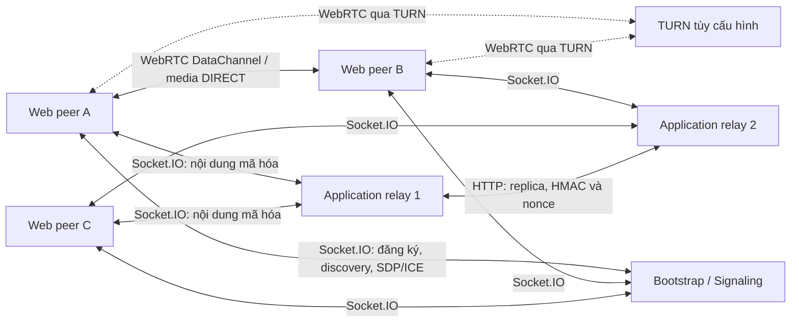

# DS01 P2P Chat — Hệ thống trò chuyện P2P qua Internet

Bài tập lớn môn **Hệ thống phân tán**, đề tài **DS01**, nhóm **3 thành viên**. Hệ thống viết bằng TypeScript, gồm web peer, bootstrap/signaling server và các application relay chạy thành những tiến trình riêng. Mỗi peer vừa khởi tạo vừa tiếp nhận kết nối, ưu tiên gửi trực tiếp qua **WebRTC DataChannel** và chuyển sang **relay Socket.IO** khi đường trực tiếp không sử dụng được.

Ứng dụng hỗ trợ chat cá nhân, chat nhóm, truyền file, gọi thoại/video, lịch sử cục bộ và sao lưu tài khoản có mã hóa. Các phần mở rộng gồm đa relay, chọn relay theo độ trễ/tải, failover, replication, mailbox offline, E2EE, DHT và bầu super-peer.

- Báo cáo: [docs/report.pdf](docs/report.pdf), [bản Markdown](docs/report.md).
- Kiến trúc và giao thức: [architecture.md](docs/architecture.md), [protocol.md](docs/protocol.md).
- Demo và nghiệm thu: [demo-script.md](docs/demo-script.md), [MANUAL-ACCEPTANCE.md](docs/MANUAL-ACCEPTANCE.md).
- Triển khai: [deploy/README.md](deploy/README.md).

## Mục lục

1. [Thành viên và phân công](#1-thành-viên-và-phân-công)
2. [Kiến trúc và giao tiếp](#2-kiến-trúc-và-giao-tiếp)
3. [Các vấn đề phân tán và cách giải quyết](#3-các-vấn-đề-phân-tán-và-cách-giải-quyết)
4. [Yêu cầu môi trường](#4-yêu-cầu-môi-trường)
5. [Cài đặt, chạy và triển khai](#5-cài-đặt-chạy-và-triển-khai)
6. [Kịch bản demo](#6-kịch-bản-demo)
7. [Kiểm thử và đánh giá](#7-kiểm-thử-và-đánh-giá)
8. [Cấu trúc repository](#8-cấu-trúc-repository)
9. [Giới hạn và hướng phát triển](#9-giới-hạn-và-hướng-phát-triển)

## 1. Thành viên và phân công

| Thành viên | MSSV | Phần việc | Mã nguồn chính |
| --- | --- | --- | --- |
| **Trịnh Thu Hồng** · `hong0110` | **B23DCVT180** | B1: signaling, discovery và tài khoản; B3: relay và định tuyến; N1: đa relay, lựa chọn và failover; N6: truyền file; N8: tải và đánh giá hiệu năng | `src/signaling/`, `src/server-kit/`, `src/relay/index.ts`, `src/shared/peer.ts`, `relaySelection.ts`, `fileTransfer.ts`; các script workload và test tương ứng |
| **Trần Hoàng Nam** · `Namtran205` | **B23DCCE070** | B2: WebRTC, NAT, STUN/TURN và chuyển đường truyền; B4: giao thức, ACK/retry/dedup và ordering; N2: replication/mailbox; N3: bầu super-peer; N7: thoại/video; D1: triển khai và CI/CD | `src/shared/directTransport.ts`, `messageDelivery.ts`, `protocol.ts`, `media.ts`, `groupMedia.ts`; `src/relay/cluster.ts`, `journal.ts`; `deploy/`, `.github/` |
| **Nguyễn Chí Ngọc** · `Ngocnguyen055` | **B23DCCE073** | B5: chat nhóm và membership/OCC; B6: giao diện và lịch sử; N4: E2EE, quản lý khóa và đồng bộ tài khoản; N5: DHT; C3: biên tập báo cáo | `src/signaling/groupHandlers.ts`, `keyDirectory.ts`; `src/shared/secure.ts`, `overlayProtocol.ts`; `src/web-peer/`, `docs/report.*` |

Các file tích hợp như `peer.ts`, signaling/relay `index.ts` và `useWebPeer.ts` có phần phối hợp của nhiều thành viên. Nền chung gồm cấu hình workspace, công cụ chạy, thư viện đường dẫn lưu trữ và thiết lập test. Cả ba cùng phân tích, tích hợp, nghiệm thu và trình bày; mỗi người viết test và nội dung báo cáo cho phần mình phụ trách.

Các nhánh công việc là `Hong`, `Nam` và `Ngoc`. Bản phát hành cần gộp đủ các phần phụ thuộc. Khi bàn giao, mỗi thành viên dùng Git identity của mình, bổ sung họ tên/MSSV vào báo cáo và thống nhất một tag cuối, chẳng hạn `v1.0.0`. Nếu repository private, cấp quyền truy cập cho tài khoản giảng viên.

## 2. Kiến trúc và giao tiếp

### 2.1. Các thành phần



| Thành phần | Cổng mặc định | Trách nhiệm |
| --- | --- | --- |
| Signaling | `4001` | Đăng ký/xác thực peer, danh sách online, lookup, heartbeat, trao đổi SDP/ICE, quản lý nhóm và phòng gọi nhóm; lưu tài khoản và bản sao tài khoản có mã hóa |
| Relay chính | `4002` | Ánh xạ Peer ID → kết nối, chuyển envelope đúng đích, mailbox, media relay và trao đổi trạng thái cluster |
| Relay dự phòng | `4003` | Tiến trình và snapshot riêng; tham gia replication và nhận lưu lượng khi peer đổi relay |
| Web | Vite `5173`; Docker `8080` | Giao diện của từng peer; trình duyệt xử lý chat, WebRTC, mã hóa và lịch sử. Launcher demo in URL riêng |
| TURN | Theo cấu hình | Chuyển lưu lượng WebRTC khi ICE chọn relay candidate; chạy riêng với application relay |

Signaling trao đổi thông tin điều khiển, không định tuyến nội dung chat giữa hai peer. API `/account/vault` và `/account/backup` lưu dữ liệu mã hóa do tài khoản chủ động sao lưu. Khi chat qua application relay, mỗi peer duy trì kết nối outbound đến relay nên không cần mở cổng nhận trên thiết bị.

Các service dùng file state riêng. Replication giữa relay đi qua HTTP; không dùng chung file, biến toàn cục hoặc vùng nhớ giữa các tiến trình để thay thế giao tiếp mạng.

### 2.2. Định danh và peer discovery

- **Peer ID** là duy nhất. Tài khoản có ID dạng `user_<username>`; chế độ kỹ thuật cho nhập ID; DHT dẫn xuất ID từ khóa ký.
- Khi tham gia, peer gửi ID, tên hiển thị, trạng thái, thông tin kết nối và bằng chứng xác thực đến signaling.
- Signaling ràng buộc danh tính với phiên/socket hiện tại, cung cấp list/lookup và phát cập nhật khi peer tham gia hoặc rời mạng.
- Peer gửi heartbeat mỗi **10 giây**. Trạng thái hết hạn sau **30 giây** không còn heartbeat hợp lệ; tác vụ quét chạy mỗi **5 giây**. Sự kiện socket disconnect có thể cập nhật sớm hơn.
- Khi signaling khởi động lại, registry danh tính và nhóm được đọc từ snapshot; trạng thái online được thiết lập lại qua đăng ký của các peer.
- Chế độ DHT dùng bản đăng ký ký số có lease trên vòng consistent-hash của các relay đã cấu hình.

Mã nguồn: [peerHandlers.ts](src/signaling/peerHandlers.ts), [presence.ts](src/signaling/presence.ts), [overlayProtocol.ts](src/shared/overlayProtocol.ts).

### 2.3. Ba đường truyền: DIRECT, TURN và RELAY

| Nhãn | Đường đi | Cách chọn |
| --- | --- | --- |
| **DIRECT** | Peer ↔ peer bằng WebRTC | DataChannel/media kết nối thành công và selected ICE candidate không dùng TURN |
| **TURN** | Peer ↔ TURN ↔ peer bằng WebRTC | ICE chọn candidate có loại `relay` |
| **RELAY** | Peer ↔ application relay Socket.IO ↔ peer | Thiết lập trực tiếp thất bại/timeout, kênh hỏng hoặc người dùng chọn kiểm tra relay |

Peer nguồn lookup đích, trao đổi SDP/ICE qua signaling và thử DataChannel. Thời gian chờ trực tiếp mặc định tối đa **10 giây**; lỗi đã xác định có thể chuyển relay sớm hơn. Sau khi kết nối, peer đọc selected candidate để xác định đúng DIRECT/TURN. ACK ứng dụng xác nhận việc nhận và lưu tin.

Gọi thoại/video ưu tiên WebRTC media. Nếu ICE không kết nối được sau khi nhận cuộc gọi, cơ chế dự phòng chuyển sang media mã hóa qua application relay sau khoảng **8 giây**. Đường RELAY này truyền frame ứng dụng riêng; TURN chuyển lưu lượng WebRTC. Trong gọi nhóm, mỗi cặp peer có thể dùng một đường truyền khác nhau.

Mã nguồn: [directTransport.ts](src/shared/directTransport.ts), [iceRoute.ts](src/shared/iceRoute.ts), [media.ts](src/shared/media.ts), [relayMedia.ts](src/shared/relayMedia.ts).

### 2.4. Giao thức và cấu trúc thông điệp

| Luồng | Giao thức |
| --- | --- |
| Tài khoản, discovery, heartbeat, SDP/ICE, quản lý nhóm | Sự kiện Socket.IO; dùng HTTPS/WSS khi triển khai public |
| Chat/file trực tiếp | JSON qua WebRTC DataChannel |
| Chat/file qua application relay | Envelope JSON qua Socket.IO |
| Cuộc gọi | WebRTC media hoặc frame media mã hóa qua Socket.IO |
| Replication và DHT liên relay | HTTP JSON có HMAC, timestamp và nonce |
| Sao lưu/khôi phục tài khoản | HTTP API với xác thực tài khoản và nội dung mã hóa |

Ví dụ một message trước khi mã hóa:

```json
{
  "messageId": "7d803729-fdd3-477b-82c3-d09492978621",
  "sessionId": "a36d1998-a5ad-49cd-ae1a-103b43ea6d36",
  "senderId": "user_alice",
  "receiverId": "user_bob",
  "groupId": null,
  "type": "text",
  "timestamp": 1795359600000,
  "logicalTime": 1795359600001,
  "sequence": 1,
  "body": "Chào Bob",
  "mode": "DIRECT",
  "ackRequested": true,
  "attempt": 1
}
```

Các loại message là `text`, `attachment`, `file-chunk` và `ack`. ACK dùng `ackFor` để tham chiếu Message ID đã nhận. Các lệnh đăng ký, heartbeat và kết nối là sự kiện điều khiển riêng.

Trạng thái trong bản ghi lịch sử gồm `pending`, `sent`, `forwarded`, `queued`, `delivered`, `failed` và `received` cho tin đến. **Forwarded** là relay đã chuyển tiếp; **queued** là relay đã lưu; **delivered** cần ACK từ peer nhận. Trên giao diện, hết lượt thử được ghi là **Chưa xác nhận**, vì ACK có thể bị mất hoặc đến muộn.

Schema và validation: [protocol.ts](src/shared/protocol.ts). Envelope mã hóa: [secure.ts](src/shared/secure.ts).

### 2.5. Các tính năng nâng cao (§5.11)

| Tính năng | Hiện thực |
| --- | --- |
| Nhiều relay | Pool relay; launcher và Compose chạy hai relay độc lập |
| Chọn relay theo độ trễ/tải | RTT EWMA, số kết nối và tin chờ; điểm = RTT + 0,25 × kết nối + 2 × tin chờ; ưu tiên relay hiện tại 10% để giảm dao động |
| Tự chuyển relay | Chọn relay còn hoạt động khi đường đang dùng lỗi; phối hợp retry cùng Message ID và dedup |
| Bầu super-peer public | Ứng cử bằng relay đồng hành HTTPS thuộc cluster, kiểm tra owner/reachability và lease; bầu Peer ID lớn nhất theo thứ tự ký tự |
| Replication | Snapshot riêng từng relay; trao đổi HTTP có xác thực, merge Lamport/version và tombstone |
| Store-and-forward | Mailbox text/ACK, TTL mặc định 24 giờ, tối đa 500 envelope chờ trên mỗi relay |
| E2EE | ECDH P-256, HKDF, AES-GCM; xác thực metadata, ghim khóa và mã hóa chat/file/ACK |
| DHT discovery | Vòng consistent-hash cấu hình sẵn, owner/successor replica, đăng ký ký số có lease |
| Truyền file | Cá nhân/nhóm, tối đa **20 MiB/file**, chia chunk, ACK/retry, SHA-256 và IndexedDB |
| STUN | Thu thập ICE candidate bằng danh sách `VITE_ICE_SERVERS` |
| WebRTC và TURN | DataChannel/media; hiển thị TURN khi selected candidate dùng TURN |
| Thoại/video prototype | Cá nhân và nhóm tối đa **8 người**; nhận/từ chối/busy, mute, tắt camera, cửa sổ di chuyển/đổi kích thước và lịch sử cuộc gọi |
| Thử tải | Script 3–100 peer mô phỏng, giới hạn concurrency; đo throughput, latency, tỷ lệ giao và kiểm tra đúng đích |

Cách cấu hình và chạy từng phần: [advanced-features.md](docs/advanced-features.md).

## 3. Các vấn đề phân tán và cách giải quyết

### 3.1. Đồng thời và nhất quán

**Lịch sử chat hội tụ cuối cùng khi các peer nhận cùng tập sự kiện hợp lệ.** Trong một hội thoại, sequence giữ thứ tự theo sender/session; logical time và Message ID dùng để merge xác định. Hệ thống không dựa riêng vào đồng hồ máy để sắp xếp tin.

**Danh sách thành viên nhóm có nguồn quyết định tại signaling.** Thay đổi gửi kèm version; kiểm tra version, cập nhật và lưu diễn ra trong cùng lượt xử lý đồng bộ. Các peer nhận phiên bản mới qua mạng và bỏ qua cập nhật cũ.

| Xung đột | Cơ chế | Mã nguồn / test |
| --- | --- | --- |
| A/B gửi hai chiều hoặc nhiều người gửi nhóm cùng lúc | Sequence theo sender/session, Lamport và ordering xác định | [ordering.ts](src/shared/ordering.ts), [direct-chat.test.ts](tests/direct-chat.test.ts), [review.test.ts](tests/review.test.ts) |
| Mất ACK, retry hoặc cùng message xuất hiện trên hai đường | Giữ Message ID, kiểm tra danh tính sự kiện, dedup và ACK bản sao hợp lệ | [messageDelivery.ts](src/shared/messageDelivery.ts), [reliable-delivery.test.ts](tests/reliable-delivery.test.ts) |
| Hai lần gửi lại cùng Message ID đến cùng receiver | Khóa in-flight theo cặp Message ID/receiver; các receiver khác nhau vẫn xử lý song song | [messageDelivery.ts](src/shared/messageDelivery.ts) |
| Hai người sửa thành viên nhóm từ cùng version | Optimistic concurrency control: một thay đổi được chấp nhận, thay đổi còn lại báo stale version | [groupHandlers.ts](src/signaling/groupHandlers.ts), [services.test.ts](tests/services.test.ts) |
| Hai bản sao lưu cùng expectedVersion | OCC, trả conflict và merge/thử lại có giới hạn ở client | [accountData.ts](src/signaling/accountData.ts), [account-recovery.test.ts](tests/account-recovery.test.ts) |
| Replica nhận mail cũ sau khi đã xóa/ACK | Version, Lamport và tombstone chặn phục hồi dữ liệu đã xóa | [journal.ts](src/relay/journal.ts), [advanced.test.ts](tests/advanced.test.ts) |

Với nhóm, một sự kiện fan-out có cùng Message ID/sequence nhưng receipt riêng cho từng receiver. Retry người chưa ACK không gửi lại cho người đã xác nhận. ACK được xử lý riêng để không phải chờ hàng đợi lưu tin đến.

Delivery semantics là **best effort có ACK tầng ứng dụng, thử lại có giới hạn và dedup**. Một sự kiện có thể được truyền nhiều lần; nơi nhận loại bản trùng trong phạm vi dữ liệu dedup được giữ. Hệ thống không cam kết exactly-once tuyệt đối.

### 3.2. Chịu lỗi và phục hồi

Mô hình lỗi gồm tiến trình dừng/khởi động lại, mất mạng, mất phản hồi, tin trễ/trùng/sai thứ tự và một relay không phản hồi.

| Tình huống | Cách xử lý |
| --- | --- |
| DataChannel không mở hoặc bị ngắt | Timeout, ghi lý do và chuyển application relay |
| Mất ACK | Chờ mặc định 2 giây sau khi truyền; tối đa **3 lần gửi tổng cộng**, cùng Message ID |
| Một relay dừng hoặc nhận kết nối nhưng không trả RPC | Timeout có giới hạn, chọn relay khác và phối hợp retry/dedup |
| Peer offline | Heartbeat/lease/disconnect cập nhật discovery; mailbox giữ text/ACK khi được bật |
| Peer reload/restart | Khôi phục phiên còn hạn, lịch sử, sequence, khóa và trạng thái gửi đã lưu |
| Signaling restart | Đọc registry/nhóm từ snapshot, peer kết nối và đăng ký lại |
| Replica bị trễ | Merge phiên bản và tombstone; chu kỳ đồng bộ mặc định 2 giây |
| File bị gián đoạn | Giới hạn chunk, ACK/retry và kiểm SHA-256; báo lỗi nếu không hoàn tất |

State server được ghi vào file tạm rồi rename. Mỗi relay giữ snapshot riêng; mailbox chỉ được xác nhận **Đã nhận** sau ACK của receiver. Hết deadline mà chưa có ACK được báo **Chưa xác nhận**; ACK hợp lệ đến muộn vẫn có thể cập nhật kết quả.

### 3.3. Bảo mật

- Tài khoản dùng **scrypt với salt ngẫu nhiên** để băm mật khẩu; đăng nhập có giới hạn tần suất và phiên có thể thu hồi.
- Peer ID được ràng buộc với phiên/socket; relay xác minh sender thay vì tin ID do client tự khai.
- Kiểm tra quyền chat, thành viên nhóm, thay đổi membership và phiên tham gia cuộc gọi.
- Schema Zod kiểm tra loại dữ liệu, trường lạ, ID, tên file, kích thước và cấu trúc envelope. Body chat tối đa 4.000 ký tự, còn chịu giới hạn byte của envelope; nội dung được hiển thị dưới dạng text.
- E2EE bảo vệ chat, file và ACK. Khóa hoạt động không cho xuất trực tiếp, lưu trong IndexedDB; vault khôi phục được mã hóa bằng mật khẩu.
- Sao lưu tài khoản dùng PBKDF2-SHA256 **600.000 vòng** và AES-GCM; relay/server vẫn thấy metadata cần cho định tuyến.
- Secret server đặt trong `.env` hoặc biến môi trường. Các biến `VITE_*` có trong bundle trình duyệt, vì vậy chỉ chứa cấu hình phía client.
- Log service có timestamp, node, loại sự kiện, đối tượng xử lý và kết quả; có thể đối chiếu Message ID giữa hai peer và relay.

Mã nguồn: [accounts.ts](src/signaling/accounts.ts), [runtime.ts](src/server-kit/runtime.ts), [secure.ts](src/shared/secure.ts), [accountCrypto.ts](src/web-peer/accountCrypto.ts).

## 4. Yêu cầu môi trường

| Thành phần | Yêu cầu |
| --- | --- |
| Node.js | **22.12+** cho quy trình chạy/test; package cũng hỗ trợ nhánh 20 từ 20.19 |
| npm | Đi kèm Node.js; repository dùng npm workspaces và lockfile |
| Trình duyệt | Có WebRTC, localStorage và IndexedDB; kiểm thử tự động dùng Chrome/Chromium |
| Mic/camera | Cấp quyền khi gọi; dùng HTTPS hoặc localhost |
| Internet demo | Có kết nối mạng và `cloudflared` đã cài; Windows có thể dùng bản portable trong thư mục runtime |
| Docker | Docker Engine/Desktop và Compose v2 nếu chạy cấu hình container |

Hệ thống DS01 độc lập không cần PostgreSQL, MongoDB hoặc RabbitMQ. Adapter cho tài khoản/nhóm của dự án bên ngoài chỉ dùng khi cấu hình Mobile API tương ứng.

Các ví dụ dưới đây dùng PowerShell và `npm.cmd`. Trên macOS/Linux, thay bằng `npm`.

## 5. Cài đặt, chạy và triển khai

### 5.1. Cài đặt

Các bước chạy áp dụng cho bản đã tích hợp đủ mã nguồn của ba thành viên. Một nhánh chỉ chứa phần việc riêng có thể còn thiếu module của nhánh khác.

```powershell
git clone https://github.com/Ngocnguyen055/DS01.git
cd DS01
npm.cmd ci
npm.cmd run setup:env
```

`setup:env` tạo `.env` từ mẫu, sinh hai secret ngẫu nhiên riêng nếu cần và giữ secret thật đã có. Không đưa `.env`, dữ liệu chạy hoặc khóa riêng lên Git; cấu hình tham khảo nằm trong [.env.example](.env.example).

### 5.2. Chạy local bằng một lệnh

```powershell
npm.cmd run demo:local
```

Launcher chạy signaling và hai relay thành các tiến trình riêng, build/phục vụ web và mở dashboard. Đợi kiểm tra khởi động hoàn tất, rồi mở các URL được in trong terminal.

| URL được in | Cách dùng |
| --- | --- |
| `Web` | Mở ba browser profile riêng để đăng nhập A/B/C |
| `Dashboard (this computer only)` | Xem PID, trạng thái, URL và log service trong trình duyệt |
| `Signaling`, `Relay`, `Relay backup` | Xem endpoint tương ứng; dashboard có liên kết `/health` |

Tạo ba tài khoản, ví dụ `alice`, `bob`, `carol`, mật khẩu tối thiểu 10 ký tự. Sau đăng nhập, các Peer ID là `user_alice`, `user_bob`, `user_carol`. Mỗi tài khoản có tối đa một peer online; khi đổi thiết bị, dùng **Chuyển phiên sang thiết bị này**.

### 5.3. Demo qua Internet

Cài `cloudflared` vào PATH hoặc đặt bản portable Windows tại `../DS01-runtime/tools/cloudflared.exe`. Nếu dùng vị trí khác, đặt biến môi trường `CLOUDFLARED_PATH` trỏ đến file thực thi trước khi chạy launcher.

```powershell
npm.cmd run demo:public
```

Đợi dòng kiểm tra endpoint/discovery/relay hoàn tất. Launcher in **Web**, **Signaling**, **Relay**, **Relay backup** và dashboard. Gửi cùng URL **Web** cho các thiết bị; chỉ người vận hành mở dashboard trên máy chạy service.

Có thể dùng laptop Wi-Fi, điện thoại 4G/5G và thiết bị thứ ba. Nếu dùng hai thiết bị, mở thêm browser profile riêng cho peer C. Giữ máy chạy service và terminal hoạt động trong buổi demo.

- URL HTTPS tunnel tồn tại theo phiên; **Ctrl+C** dừng launcher và các tunnel.
- Khi đổi mã nguồn/cấu hình ICE, dừng phiên cũ, chạy lại và mở URL Web mới trên các thiết bị.
- Hai thiết bị cùng Wi-Fi hoặc khác mạng đều có thể đi DIRECT hoặc RELAY tùy ICE, NAT, VPN và firewall. Quan sát nhãn/log thực tế.
- **Ưu tiên relay khi gửi tin** kiểm tra application relay; **Kiểm tra cuộc gọi qua relay** mô phỏng chặn ICE cho cuộc gọi mới. Hai tùy chọn có phạm vi riêng.
- Cloudflare Tunnel công khai endpoint web/Socket.IO; TURN được cấu hình riêng qua `VITE_ICE_SERVERS`.

Hai lệnh kiểm tra khởi động rồi tự dừng dùng kho dữ liệu tách biệt:

```powershell
npm.cmd run demo:check
npm.cmd run demo:public:check
```

### 5.4. Chạy từng thành phần khi phát triển

Mở ba terminal tại thư mục gốc:

| Terminal | Lệnh |
| --- | --- |
| Signaling | `npm.cmd run dev:signaling` |
| Một relay | `npm.cmd run dev:relay` |
| Web Vite | `npm.cmd run dev:web` |

Mở `http://localhost:5173`. **`dev:web` chỉ chạy giao diện**; signaling và relay cần chạy cùng. Dùng launcher local/public khi cần sẵn hai relay và dashboard.

### 5.5. Dữ liệu và đổi thiết bị

Với checkout `F:\Downloads\DS01`, runtime mặc định là `F:\Downloads\DS01-runtime`. Thay đổi bằng `DS01_RUNTIME_DIR`; `DS01_DATA_DIR` đặt riêng nơi giữ dữ liệu bền.

| Vị trí | Nội dung |
| --- | --- |
| `DS01-runtime/data/accounts.json` | Tài khoản, hash mật khẩu và phiên đăng nhập |
| `data/signaling.json`, `data/signaling.json.keys.json` | Registry, nhóm và danh mục khóa |
| `data/account-data/` | Vault khôi phục và bản sao tài khoản có mã hóa |
| `data/relay-primary.json`, `data/relay-backup.json` | Mailbox và journal riêng từng relay |
| `data/service-secrets.json` | Secret demo bền khi chưa cấu hình trong môi trường |
| `ds01-public-demo-*/`, `tmp/`, `browser-*/` | Build, log và dữ liệu kiểm thử của từng lần chạy |
| localStorage / IndexedDB của trình duyệt | Lịch sử, receipt, danh bạ, cuộc gọi, file và khóa của từng peer |

Tài khoản cũ trong `.data` được launcher hỗ trợ nhập vào kho dữ liệu chung. Khi dọn log, giữ thư mục `data/`. Local, public và các lệnh service dùng chung kho mặc định này; test dùng dữ liệu riêng.

Để chuyển thiết bị, đợi **Tình trạng kết nối → Kết nối nâng cao → Đã đồng bộ**, rồi đăng nhập cùng tài khoản/mật khẩu ở thiết bị mới. Dữ liệu chưa từng sao lưu còn ở trình duyệt cũ; có thể dùng **Xuất lịch sử hội thoại** và **Nhập lịch sử từ phiên bản cũ**. Hướng dẫn: [authentication.md](docs/authentication.md).

### 5.6. Docker, server public và triển khai lại

```powershell
docker compose --env-file .env -f deploy/compose.yml up --build -d --wait
docker compose --env-file .env -f deploy/compose.yml ps
docker compose --env-file .env -f deploy/compose.yml logs -f signaling relay relay-backup
```

Bản Compose mở web tại `http://localhost:8080` trên máy host. Signaling, hai relay và web là các container riêng; signaling và mỗi relay có named volume riêng. Muốn dùng từ thiết bị khác, cấu hình URL public và HTTPS reverse proxy theo [deploy/README.md](deploy/README.md).

| Biến cấu hình | Mục đích |
| --- | --- |
| `JWT_SECRET`, `PEER_SECRET` | Hai secret server khác nhau, ngẫu nhiên |
| `VITE_SIGNAL_URL` | URL signaling mà trình duyệt truy cập |
| `VITE_RELAY_URL`, `VITE_RELAY_URLS` | Relay chính và danh sách relay bổ sung |
| `VITE_ICE_SERVERS`, `VITE_ICE_POLICY` | JSON STUN/TURN và chính sách ICE |
| `PUBLIC_SIGNAL_URL`, `PUBLIC_RELAY_URL`, `PUBLIC_RELAY_BACKUP_URL` | Endpoint public cho cấu hình triển khai/probe |
| `SIGNAL_INTERNAL_URL` | Địa chỉ signaling dùng giữa các service |
| `RELAY_CLUSTER_URLS`, `RELAY_CLUSTER_ROUTES` | Tập relay canonical và ánh xạ đường gọi nội bộ |
| `RELAY_OFFLINE_QUEUE` | Bật mailbox bằng giá trị `1` |
| `SUPER_PEER_ID`, `SUPER_PEER_BACKUP_ID` | Owner của relay đồng hành khi demo election |

Các biến `VITE_*` được đưa vào web lúc build. Sau khi đổi URL/ICE cần build lại web hoặc khởi động lại launcher. Mẫu server/domain và TURN: [internet.env.example](deploy/internet.env.example), [Caddyfile.example](deploy/Caddyfile.example), [turnserver.conf.example](deploy/turnserver.conf.example).

Khi redeploy, giữ `.env` và volumes, sao lưu state rồi cập nhật revision đã được nhóm kiểm tra và chạy lại lệnh `up --build -d --wait`. Docker dùng `/app/.data`; khi chuyển từ Node sang container cần chuyển cả registry và `account-data/`. `docker compose down` giữ named volume; thêm `-v` sẽ xóa dữ liệu trong volume.

### 5.7. CI/CD

| Workflow | Kích hoạt | Công việc |
| --- | --- | --- |
| [DS01 CI](.github/workflows/ci.yml) | Push, pull request hoặc chạy thủ công | Cài bằng lockfile; typecheck, lint, evaluate, build web, audit; bốn bộ Chrome regression; build hai Docker target; lưu artifact |
| [DS01 manual delivery](.github/workflows/delivery.yml) | Chạy thủ công trong Actions | Chạy lại CI, publish image app/web lên GHCR; tùy chọn deploy bằng SSH |
| [Dependabot](.github/dependabot.yml) | Theo lịch cấu hình | Đề xuất cập nhật dependency và GitHub Actions |

Mở **Actions → DS01 manual delivery → Run workflow**. `deploy=false` chỉ kiểm tra và phát hành image; `deploy=true` triển khai lên server đã chuẩn bị qua environment `production`.

Cấu hình các variable URL `VITE_SIGNAL_URL`, `VITE_RELAY_URL`, `VITE_RELAY_URLS`, tùy chọn `VITE_ICE_SERVERS` và `DEPLOY_PATH`; các secret triển khai là `DEPLOY_HOST`, `DEPLOY_USER`, `DEPLOY_SSH_KEY`, `DEPLOY_KNOWN_HOSTS`. Server cần Docker/Compose, HTTPS và quyền đọc image. Workflow dùng image tag `sha-<commit>` và chờ health. Nếu cập nhật thất bại và đã có release trước đó, script quay về image của release trước.

Cấu hình đầy đủ: [deploy/README.md](deploy/README.md). Kết quả pipeline nằm ở từng Actions run; Dockerfile/workflow là cấu hình triển khai, không tự tạo máy chủ hoặc domain.

## 6. Kịch bản demo

### 6.1. Mười hai tình huống bắt buộc (§5.10)

Khởi động bằng `npm.cmd run demo:public`, mở dashboard trên máy vận hành và đăng nhập A/B/C bằng ba tài khoản riêng. Trong peer, mở **Tình trạng kết nối** để xem/xuất log; bấm **Chi tiết** của tin nhắn để lấy Message ID, Session, Sequence và Lamport.

| Bước | Thao tác | Kết quả và bằng chứng |
| --- | --- | --- |
| 1. Service public | Đợi launcher kiểm tra xong; mở `/health` signaling và hai relay qua URL HTTPS | Endpoint phản hồi; dashboard hiện các PID service độc lập |
| 2. Ba peer | Đăng nhập A/B/C trên thiết bị hoặc profile riêng | Mỗi peer có ID riêng, tên/ID đúng trên giao diện và tiêu đề tab |
| 3. Discovery | Cho C kết nối khi A/B đang mở | Danh sách A/B cập nhật C; C thấy A/B |
| 4. Direct P2P | Tắt ưu tiên relay, A chọn B và gửi khi mạng cho phép kết nối trực tiếp | Tin có nhãn DIRECT và ACK; nếu nhãn TURN thì đường WebRTC đang qua TURN |
| 5. Chứng minh bỏ qua relay | Lấy Message ID ở bước 4, đối chiếu log hai peer và lọc dashboard | Có DIRECT SEND/RECEIVE, relay vẫn hoạt động nhưng không FORWARD ID đó; bộ đếm relay không tăng vì tin này |
| 6. Hai mạng qua relay | Đặt A/B ở hai mạng; tạo điều kiện đường trực tiếp thất bại/timeout rồi gửi | Tin tự đến bằng RELAY. Nếu vẫn DIRECT thì cần tình huống firewall/NAT chặn hoặc mạng mô phỏng cô lập |
| 7. Chứng minh relay | Lọc cùng Message ID ở A, B và dashboard | RELAY SEND → relay FORWARD → RELAY RECEIVE; A nhận ACK |
| 8. Chat nhóm | A tạo nhóm có A/B/C; mỗi người gửi một tin | Ba giao diện nhận đủ; tin fan-out có receipt riêng từng người |
| 9. Đồng thời | B/C nhập trước nội dung rồi gửi gần cùng lúc, lặp vài vòng | A/B/C có cùng các sự kiện, không trùng; đối chiếu ID, Sequence, Lamport và ACK |
| 10. Peer dừng đột ngột | Chrome của C: Shift+Esc, kết thúc renderer/tab C; giữ A/B mở | C chuyển offline; log có disconnect hoặc timeout. Dùng profile riêng để cô lập peer |
| 11. DIRECT → RELAY | Khi A/B đang DIRECT, tại A mở chẩn đoán và bấm Ngắt kênh trực tiếp; gửi tiếp với ưu tiên relay vẫn tắt | DataChannel thật đóng; tin sau tự chuyển RELAY và có log FORWARD |
| 12. Restart peer | Reload tab C bằng profile cũ, đăng nhập lại nếu phiên không còn | C giữ đúng Peer ID, phục hồi lịch sử/nhóm và xuất hiện online trở lại |

Checkbox ưu tiên relay chỉ chứng minh đường relay hoạt động. Để chứng minh fallback do mạng, cần ghi nhận direct attempt thất bại/timeout trước khi tin được chuyển tiếp.

### 6.2. Chứng minh concurrency và consistency (§4.3)

**Gửi đồng thời:** B/C cùng gửi `B-1`/`C-1`, rồi `B-2`/`C-2` vào nhóm A/B/C. Sau khi nhận đủ, cả ba có cùng bốn sự kiện hợp lệ, mỗi sự kiện hiển thị một lần; tin của B và C giữ thứ tự theo sender. Xuất lịch sử để đối chiếu Message ID, sequence, logical time và receipt.

**Xung đột membership:** với nhóm A/B/C ở version 1, A xóa C trong lúc B tự rời nhóm. Khi hai yêu cầu cùng version 1, chỉ một yêu cầu thành công; nhóm thành version 2 và các peer nhận cùng kết quả. Nếu thao tác UI đến lần lượt với version mới thì cả hai có thể thành công ở hai version khác nhau. Test tự động tạo chính xác cuộc đua cùng version:

```powershell
npm.cmd test -- tests/services.test.ts tests/group-chat.test.ts tests/reliable-delivery.test.ts --reporter=verbose
```

Test còn kiểm tra retry trùng ID, dữ liệu đến sai thứ tự, ACK chậm/sai ngữ cảnh và quyền bị thu hồi. Kết quả cuối cần đối chiếu là membership đúng version/quyền, lịch sử không tạo bản nhận trùng và receipt đúng receiver.

### 6.3. Demo các phần nâng cao

| Tình huống | Thao tác và kết quả cần thấy |
| --- | --- |
| Relay failover | Kết nối hai relay; cho đường application relay hoạt động, dừng tiến trình relay đang dùng bằng Task Manager hoặc container; gửi tiếp và đối chiếu relay mới/ACK |
| Mailbox và replication | A/B đã liên lạc và công bố khóa, B đăng xuất; A gửi text và thấy Relay đã lưu. Chờ `REPLICA_MERGE`, dừng relay nhận ban đầu, cho B trở lại; B nhận một lần và A chuyển Đã nhận |
| DHT | Đăng xuất → Chế độ thử nghiệm → nhập tên → Kết nối bằng DHT; cho các peer tham gia rồi dừng signaling. Discovery/chat/file/gọi tiếp tục qua overlay relay |
| Super-peer | Chạy relay HTTPS public trong cluster với owner trùng Peer ID; nhập URL ở Kết nối nâng cao và ứng cử. Xem `ELECTION_CANDIDATE`, `ELECTION_RESULT`; dừng/gỡ ứng viên và quan sát hết lease |
| E2EE | Xem fingerprint, xác minh khóa qua kênh riêng; log/snapshot relay không có body chat dạng rõ; test sửa ciphertext phải bị từ chối |
| File cá nhân/nhóm | Bấm +, gửi file khi các receiver online; theo dõi tiến độ, ACK riêng và tải lại sau reload; kiểm hash trong test |
| Thoại/video và TURN | Gọi, nhận, mute, tắt camera, kết thúc; xem nhãn DIRECT/TURN theo candidate thực tế và lịch sử trong hội thoại |
| Media RELAY | Kết thúc cuộc gọi cũ; bật Kiểm tra cuộc gọi qua relay ở một đầu, gọi lại và nhận. Chờ khoảng 8 giây; hai đầu của cặp chuyển RELAY, tiếng/hình đi qua frame mã hóa |
| Gọi nhóm | Tạo nhóm A/B/C, bắt đầu thoại/video và cho cả ba tham gia; kiểm mic/camera từng người. Đường truyền được xác định riêng cho từng cặp |
| Đổi thiết bị | Đợi Đã đồng bộ, đăng nhập cùng tài khoản/mật khẩu ở profile mới với chuyển phiên; kiểm ID, khóa, lịch sử và file trong ngân sách sao lưu |

## 7. Kiểm thử và đánh giá

### 7.1. Kiểm tra mã nguồn và test tự động

```powershell
npm.cmd run typecheck
npm.cmd run lint
npm.cmd test
npm.cmd run build:web
npm.cmd run evaluate
```

`evaluate` chạy Vitest và tạo ma trận theo mục 9 của đề. Ngưỡng là ít nhất **8 functional, 2 concurrency, 2 fault/recovery và 2 security**; cấu hình hiện ánh xạ 8/3/3/3 kịch bản. Thử nghiệm hiệu năng được chạy riêng.

| Nhóm kiểm thử | Nội dung chính | Test / lệnh |
| --- | --- | --- |
| Chức năng | Đăng ký/discovery, chat hai chiều, nhóm, ordering, dedup, file và DHT | `discovery`, `direct-chat`, `group-chat`, `reliable-delivery`, `advanced` |
| Đồng thời/xung đột | Trùng Peer ID, membership cùng version, gửi hai chiều/nhóm, backup OCC, replica merge | `services`, `accounts`, `review`, `account-recovery`, `advanced` |
| Lỗi/phục hồi | Peer crash/restart, mất ACK, storage lỗi, DIRECT hỏng, relay timeout/failover, mailbox | `fault-tolerance`, `recovery-advanced`, `reliable-delivery`; browser regression |
| Bảo mật/dữ liệu sai | Giả sender/token, quyền nhóm, format/size, ciphertext/khóa sai, cluster replay | `security`, `relay`, `protocol`, `advanced` |
| Hiệu năng | Độ trễ ACK DIRECT/RELAY, throughput, tỷ lệ giao, phát hiện offline, đổi relay và số kết nối | `test:browser`, `benchmark:relay`, `load:relay` |

Tên rút gọn trong bảng tương ứng với `tests/<tên>.test.ts`. Tài liệu: [test-plan.md](docs/test-plan.md), [manual-results.csv](docs/manual-results.csv).

### 7.2. Kiểm thử bằng trình duyệt thật

```powershell
npm.cmd run test:browser
npm.cmd run test:browser:advanced
npm.cmd run test:browser:groups
npm.cmd run test:browser:accounts
```

| Bộ chạy | Phạm vi |
| --- | --- |
| `test:browser` | Ba peer, tài khoản/UI desktop/mobile, DataChannel thật, ACK/log path, file/IndexedDB, đồng thời, crash/restart, failover và ma trận tải |
| `test:browser:advanced` | STUN/TURN UDP, E2EE, RTP audio/video, media RELAY, mailbox và DHT |
| `test:browser:groups` | Gọi nhóm ba peer, các đường DIRECT/TURN/RELAY, rejoin, quyền, lịch sử và file nhóm |
| `test:browser:accounts` | Khôi phục khóa/lịch sử/file giữa profile/origin, chuyển phiên và đồng bộ có version |

Có thể đặt `CHROME_PATH` nếu Chromium không nằm ở vị trí script nhận diện. Các bộ chạy dùng profile và service tách biệt; media lab dùng mic/camera giả, STUN/TURN loopback. Ghi rõ topology và thiết bị thật khi lập biên bản demo Internet.

### 7.3. Đo hiệu năng và lưu bằng chứng

Khi signaling/relay đang chạy:

```powershell
npm.cmd run benchmark:relay
npm.cmd run load:relay -- --peers 20 --messages 10 --concurrency 8
```

`benchmark:relay` đo chuyển tiếp relay với 100 envelope tuần tự. `load:relay` tạo nhiều peer Socket.IO; `test:browser` chạy ma trận 3/20/50/100 peer và đo thêm các luồng có ACK ứng dụng. Phép đo Socket.IO headless không bao gồm toàn bộ chi phí browser, mã hóa và lưu lịch sử.

Các bộ evaluate/browser in kết quả và lưu hồ sơ trong các thư mục `../DS01-runtime/evaluation-*`, `browser-smoke-*`, `browser-advanced-*`, `browser-groups-*`, `browser-account-recovery-*`. Benchmark/load in số đo JSON ra terminal. Hồ sơ dùng trong báo cáo nằm tại [docs/evidence/](docs/evidence/README.md).

Mỗi kết quả cần đi kèm revision/fingerprint, trạng thái working tree, thời điểm chạy, môi trường, topology, payload và concurrency. So sánh độ trễ DIRECT/RELAY phải dùng cùng payload và xác nhận đường đi bằng log/candidate. Ảnh và JSON của một lần chạy chỉ mô tả phiên bản và môi trường của lần đó.

## 8. Cấu trúc repository

```text
.
├── README.md
├── .env.example
├── package.json
├── package-lock.json
├── tsconfig.base.json
├── src/
│   ├── shared/
│   ├── signaling/
│   ├── relay/
│   ├── server-kit/
│   └── web-peer/
├── deploy/
│   ├── Dockerfile
│   ├── compose.yml
│   ├── compose.images.yml
│   ├── Caddyfile.example
│   └── turnserver.conf.example
├── scripts/
├── tests/
├── .github/
│   ├── workflows/ci.yml
│   ├── workflows/delivery.yml
│   └── dependabot.yml
└── docs/
    ├── report.md
    ├── report.pdf
    ├── architecture.md
    ├── protocol.md
    ├── demo-script.md
    ├── MANUAL-ACCEPTANCE.md
    └── evidence/
```

`src/shared/` chứa giao thức và logic peer; `server-kit/` chứa công cụ server/lưu trữ. `scripts/` phục vụ khởi động, fault injection, workload và browser test. Build, cache, secret và dữ liệu runtime được loại khỏi Git qua [.gitignore](.gitignore).

## 9. Giới hạn và hướng phát triển

- Signaling và kho tài khoản có một nguồn ghi; chưa có replication/failover cho thành phần này. Membership nhóm phụ thuộc signaling.
- Replication relay là bất đồng bộ. Mail mới có thể mất nếu relay hỏng trước khi sao chép; hai relay trên cùng host không bảo vệ khi cả host dừng.
- DHT là prototype vòng hash tĩnh trên tập relay cấu hình sẵn; chế độ này hỗ trợ cá nhân/file/cuộc gọi, chưa có tài khoản hoặc nhóm. Election theo lease hội tụ cuối cùng và có thể tạm khác leader khi phân vùng; không dùng Raft.
- STUN không bảo đảm vượt mọi NAT/firewall. TURN cần endpoint/credentials và cấu hình mạng phù hợp. Media RELAY dùng âm thanh/frame video giới hạn chất lượng; prototype chưa thay thế nền tảng hội nghị quy mô lớn.
- Nhóm chat tối đa 16 thành viên; cuộc gọi nhóm tối đa 8 người theo mesh, nên chi phí kết nối/băng thông tăng theo số người.
- File tối đa 20 MiB, người nhận cần online; chưa resume qua restart hoặc giữ chunk trong mailbox offline. Bản sao tài khoản giữ tối đa 8 MiB dữ liệu file trong archive tối đa 16 MiB trước mã hóa.
- Lịch sử giữ tối đa 1.000 dòng và 10.000 khóa dedup mỗi peer. Ordering là trong hội thoại, không phải total order toàn hệ thống; dedup có giới hạn lưu trữ.
- Mỗi tài khoản có một peer online; chuyển thiết bị dựa vào bản sao gần nhất. Chưa có khôi phục mật khẩu; mất mật khẩu và mọi bản khóa đang dùng có thể mất khả năng mở vault. Việc tin khóa lần đầu cần signaling tin cậy hoặc đối chiếu ngoài kênh.
- Rollback triển khai phục hồi phiên bản image, không tự đảo ngược thay đổi dữ liệu/schema.

Hướng mở rộng gồm signaling dự phòng, quorum cho dữ liệu quan trọng, TURN có credential ngắn hạn, DHT thay đổi thành viên động, resume file, đồng bộ đa thiết bị và kiến trúc media phù hợp nhóm lớn.
