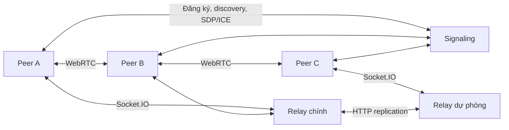

# DS01: P2P chat system simulating Skype

Bài tập lớn môn **Hệ thống phân tán**, thực hiện bởi nhóm 3 thành viên.

Ứng dụng cho phép các peer nhắn tin, gửi file và gọi thoại/video qua Internet. Peer thử kết nối trực tiếp bằng WebRTC; nếu không kết nối được, dữ liệu được chuyển qua relay. Mã nguồn viết bằng TypeScript, giao diện web dùng React.

Hiện nhóm chạy demo bằng Node.js và Cloudflare Tunnel. Cấu hình Docker và workflow CD đã có trong repo; việc đưa hệ thống lên máy chủ thường trực nằm trong [hướng phát triển](#9-giới-hạn-và-hướng-phát-triển).

## Mục lục

1. [Thành viên và phân công](#1-thành-viên-và-phân-công)
2. [Chức năng và kiến trúc](#2-chức-năng-và-kiến-trúc)
3. [Đồng thời, chịu lỗi và bảo mật](#3-đồng-thời-chịu-lỗi-và-bảo-mật)
4. [Cài đặt và chạy local](#4-cài-đặt-và-chạy-local)
5. [Demo qua Internet](#5-demo-qua-internet)
6. [Kịch bản demo](#6-kịch-bản-demo)
7. [Kiểm thử và CI](#7-kiểm-thử-và-ci)
8. [Mã nguồn và tài liệu](#8-mã-nguồn-và-tài-liệu)
9. [Giới hạn và hướng phát triển](#9-giới-hạn-và-hướng-phát-triển)

## 1. Thành viên và phân công

| Thành viên | MSSV | Phần việc | Mã nguồn chính |
| --- | --- | --- | --- |
| **Trần Hoàng Nam** · `Namtran205` | **B23DCCE070** | B2: WebRTC, NAT, STUN/TURN và chuyển đường truyền; B4: giao thức, ACK/retry/dedup và ordering; N2: replication/mailbox; N3: bầu super-peer; N7: thoại/video; D1: triển khai và CI/CD | `src/shared/directTransport.ts`, `messageDelivery.ts`, `protocol.ts`, `media.ts`, `groupMedia.ts`; `src/relay/cluster.ts`, `journal.ts`; `deploy/`, `.github/` |
| **Trịnh Thu Hồng** · `hong0110` | **B23DCVT180** | B1: signaling, discovery và tài khoản; B3: relay và định tuyến; N1: đa relay, lựa chọn và failover; N6: truyền file; N8: tải và đánh giá hiệu năng | `src/signaling/`, `src/server-kit/`, `src/relay/index.ts`, `src/shared/peer.ts`, `relaySelection.ts`, `fileTransfer.ts`; các script workload và test tương ứng |
| **Nguyễn Chí Ngọc** · `Ngocnguyen055` | **B23DCCE073** | B5: chat nhóm và membership/OCC; B6: giao diện và lịch sử; N4: E2EE, quản lý khóa và đồng bộ tài khoản; N5: DHT; C3: biên tập báo cáo | `src/signaling/groupHandlers.ts`, `keyDirectory.ts`; `src/shared/secure.ts`, `overlayProtocol.ts`; `src/web-peer/`, `docs/report.*` |

Cả ba cùng phân tích, tích hợp, kiểm thử và trình bày. Các file dùng chung như `peer.ts`, `useWebPeer.ts` và entry point của service có phần phối hợp giữa các thành viên.

## 2. Chức năng và kiến trúc

### Chức năng

- Đăng ký, đăng nhập, tìm peer và cập nhật trạng thái online/offline.
- Chat cá nhân, tạo nhóm, thêm/xóa thành viên và gửi tin cho cả nhóm.
- Hiển thị đường truyền và trạng thái giao tin; lưu lịch sử trên thiết bị.
- Gửi file cá nhân/nhóm tối đa **20 MiB**, chia chunk và kiểm SHA-256.
- Gọi thoại/video cá nhân và nhóm tối đa **8 người**; mute, tắt camera và lưu lịch sử cuộc gọi.
- Sao lưu lịch sử, khóa và một phần file dưới dạng mã hóa để khôi phục khi đổi thiết bị.

Các phần mở rộng gồm nhiều relay, chọn relay theo độ trễ/tải, tự chuyển relay, sao chép trạng thái, lưu chuyển tiếp text/ACK cho peer offline, mã hóa đầu cuối, DHT và bầu super-peer. WebRTC hỗ trợ cấu hình STUN/TURN; máy chủ TURN được cấu hình riêng. Chi tiết tại [advanced-features.md](docs/advanced-features.md).

### Các thành phần



| Thành phần | Cổng mặc định | Vai trò |
| --- | --- | --- |
| Signaling | `4001` | Tài khoản, discovery, heartbeat, trao đổi SDP/ICE, nhóm và phòng gọi |
| Relay chính | `4002` | Chuyển dữ liệu đến đúng peer, mailbox offline và media relay |
| Relay dự phòng | `4003` | Nhận lưu lượng khi peer chuyển relay; giữ bản sao trạng thái riêng |
| Web peer | `5173` khi chạy Vite | Giao diện, WebRTC, mã hóa và lịch sử cục bộ |

Launcher demo tự chọn cổng trống và in URL thực tế. Signaling và hai relay chạy thành các tiến trình riêng. Relay trao đổi trạng thái qua mạng, không dùng chung file state.

Signaling xử lý thông tin điều khiển, không chuyển tiếp tin chat trực tiếp giữa các peer. API sao lưu tài khoản lưu bản mã do client gửi lên.

### Đường truyền

| Nhãn | Đường đi |
| --- | --- |
| **DIRECT** | WebRTC giữa hai peer, không qua relay |
| **TURN** | WebRTC qua máy chủ TURN khi ICE chọn candidate loại `relay` |
| **RELAY** | Dữ liệu đi qua application relay bằng Socket.IO |

Peer nguồn tìm peer đích, trao đổi SDP/ICE rồi thử DataChannel. Thời gian chờ trực tiếp mặc định là **10 giây**; kết nối lỗi có thể chuyển relay sớm hơn. Cuộc gọi có cơ chế media relay sau khoảng **8 giây** nếu WebRTC không kết nối được sau khi nhận cuộc gọi. Với gọi nhóm, đường truyền được xác định riêng cho từng cặp.

Cloudflare Tunnel cung cấp URL HTTPS cho web và service. STUN/TURN phục vụ việc thiết lập WebRTC; cấu hình bằng `VITE_ICE_SERVERS`.

Mã nguồn: [directTransport.ts](src/shared/directTransport.ts), [iceRoute.ts](src/shared/iceRoute.ts), [media.ts](src/shared/media.ts), [relayMedia.ts](src/shared/relayMedia.ts).

## 3. Đồng thời, chịu lỗi và bảo mật

### Đồng thời và nhất quán

| Tình huống | Cách xử lý |
| --- | --- |
| Nhiều peer gửi cùng lúc | Sequence theo sender/session, Lamport và quy tắc sắp xếp xác định |
| Retry hoặc nhận cùng tin qua nhiều đường | Giữ Message ID, kiểm tra nội dung sự kiện và loại bản trùng |
| Gửi nhóm | Theo dõi ACK riêng từng người; chỉ retry người chưa xác nhận |
| Hai thay đổi thành viên cùng version | OCC: một yêu cầu thành công, yêu cầu còn lại nhận lỗi version cũ |
| Hai bản sao lưu cùng version | Báo conflict, merge và thử lại có giới hạn |
| Replica đến trễ sau khi mail đã xóa | Version, Lamport và tombstone ngăn khôi phục mail cũ |

Lịch sử chat hội tụ khi các peer nhận cùng tập sự kiện hợp lệ. Danh sách thành viên nhóm do signaling quyết định và phân phối theo version.

Hệ thống dùng ACK tầng ứng dụng, retry có giới hạn và dedup. Mỗi lần gửi thử tối đa **3 lần tổng cộng**, giữ nguyên Message ID. Trạng thái **Đã chuyển tiếp** hoặc **Relay đã lưu** chưa có nghĩa peer đích đã nhận; **Đã nhận** cần ACK từ peer đích. Hết lượt thử được hiển thị là **Chưa xác nhận**.

Mã nguồn: [protocol.ts](src/shared/protocol.ts), [messageDelivery.ts](src/shared/messageDelivery.ts), [ordering.ts](src/shared/ordering.ts), [groupHandlers.ts](src/signaling/groupHandlers.ts).

### Chịu lỗi

Peer gửi heartbeat mỗi **10 giây**. Thông tin hết hạn sau **30 giây** không có heartbeat hợp lệ, được quét mỗi **5 giây**; socket disconnect có thể được phát hiện sớm hơn.

Khi DataChannel hỏng, peer chuyển sang relay. Khi relay không phản hồi, client thử relay khác. Mailbox giữ text/ACK cho peer offline khi được bật; ACK từ peer nhận mới xác nhận giao tin thành công. Tài khoản, nhóm và snapshot riêng của từng relay được lưu để phục hồi sau restart.

Replication giữa relay là bất đồng bộ, nên có thể mất dữ liệu nếu relay dừng trước khi kịp sao chép.

### Bảo mật

Mật khẩu được băm bằng scrypt với salt ngẫu nhiên. Phiên có thể thu hồi; Peer ID được ràng buộc với phiên/socket. Server kiểm tra quyền, schema, kích thước và tần suất yêu cầu. Chat tối đa **4.000 ký tự**, đồng thời chịu giới hạn byte của envelope.

Chat/file/ACK dùng E2EE; bản sao tài khoản được mã hóa bằng khóa dẫn xuất từ mật khẩu. Relay vẫn thấy metadata định tuyến. Secret server đặt trong `.env`; các biến `VITE_*` nằm trong bundle trình duyệt nên chỉ chứa cấu hình phía client.

## 4. Cài đặt và chạy local

Cần **Node.js 22.12+**, npm và trình duyệt có WebRTC/IndexedDB. Gọi thoại/video cần quyền mic/camera; dùng localhost hoặc HTTPS.

Các ví dụ dùng PowerShell. Trên Linux/macOS, thay `npm.cmd` bằng `npm`.

```powershell
git clone https://github.com/Ngocnguyen055/DS01.git
cd DS01
npm.cmd ci --cache .npm-cache
npm.cmd run setup:env
npm.cmd run demo:local
```

`setup:env` tạo `.env` và sinh hai secret riêng nếu cần, giữ nguyên secret thật đã có. Mẫu cấu hình ở [.env.example](.env.example). Launcher chạy signaling, hai relay, web và dashboard. Mở URL **Web** được in trong terminal.

Tạo ba tài khoản, ví dụ `alice`, `bob`, `carol`, mật khẩu tối thiểu 10 ký tự. Peer ID tương ứng là `user_alice`, `user_bob`, `user_carol`. Dùng ba browser profile riêng để tránh dùng chung dữ liệu phiên. Mỗi tài khoản có một peer online; khi đổi thiết bị, chọn **Chuyển phiên sang thiết bị này**.

Dashboard mở trên máy chạy service, dùng để xem PID, trạng thái và log. **Ctrl+C** dừng phiên demo.

Khi cần chạy từng thành phần để sửa code, mở ba terminal:

| Thành phần | Lệnh |
| --- | --- |
| Signaling | `npm.cmd run dev:signaling` |
| Một relay | `npm.cmd run dev:relay` |
| Web | `npm.cmd run dev:web` |

Web Vite ở `http://localhost:5173`. Lệnh `dev:web` chỉ chạy giao diện; dùng launcher nếu cần sẵn hai relay và dashboard.

## 5. Demo qua Internet

Tải [cloudflared](https://developers.cloudflare.com/tunnel/downloads/) và cài vào PATH, hoặc đặt bản Windows tại `../DS01-runtime/tools/cloudflared.exe`. Sau đó chạy:

```powershell
npm.cmd run demo:public
```

Nếu lưu công cụ ở vị trí khác:

```powershell
$env:CLOUDFLARED_PATH = 'F:\Tools\cloudflared.exe'
npm.cmd run demo:public
```

Chờ kiểm tra khởi động hoàn tất rồi gửi cùng URL **Web** cho các thiết bị. Có thể dùng laptop Wi-Fi, điện thoại 4G/5G và thiết bị thứ ba. Người tham gia chỉ cần trình duyệt; máy chạy service phải giữ kết nối mạng và terminal hoạt động.

Người clone có thể tự tạo phiên demo và URL riêng. Phiên đó dùng backend và tài khoản trên máy của họ. Không đưa `.env`, token, dữ liệu chạy hoặc cloudflared lên Git; URL tunnel thay đổi theo phiên.

Sau khi đổi mã nguồn hoặc cấu hình ICE, dừng phiên cũ, chạy lại và mở URL mới trên các thiết bị. DIRECT có thiết lập được hay không phụ thuộc NAT, VPN và firewall; xem nhãn đường truyền và log thực tế.

### Dữ liệu

Với checkout `F:\Downloads\DS01`, dữ liệu chạy mặc định ở `F:\Downloads\DS01-runtime`. Có thể đổi bằng `DS01_RUNTIME_DIR` và `DS01_DATA_DIR`.

| Nơi lưu | Nội dung |
| --- | --- |
| `DS01-runtime/data/` | Tài khoản, hash mật khẩu, nhóm, vault và bản sao tài khoản mã hóa, state của từng relay |
| `ds01-public-demo-*/`, `browser-*/`, `evaluation-*/` trong runtime | Build, log và kết quả kiểm thử |
| localStorage/IndexedDB | Lịch sử, file, khóa và receipt trên thiết bị người dùng |

Local/public dùng chung kho mặc định; các bài kiểm thử dùng kho riêng. Khi dọn log, giữ thư mục `data/` và secret đang dùng.

Để đổi thiết bị, đợi **Tình trạng kết nối → Kết nối nâng cao → Đã đồng bộ**, rồi đăng nhập cùng tài khoản và mật khẩu. Dữ liệu chưa sao lưu vẫn ở thiết bị cũ. Chi tiết tại [authentication.md](docs/authentication.md).

## 6. Kịch bản demo

Chạy `demo:public`, mở dashboard trên máy vận hành và đăng nhập A/B/C. Trong giao diện, mở **Tình trạng kết nối** để xem/xuất log; bấm **Chi tiết** của tin nhắn để đối chiếu Message ID, Session, Sequence và Lamport.

| Bước | Thao tác | Kết quả cần thấy |
| --- | --- | --- |
| 1 | Mở URL HTTPS của web và `/health` của signaling/relay từ thiết bị khác mạng | Các endpoint phản hồi |
| 2 | Đăng nhập A/B/C trên thiết bị hoặc profile riêng | Ba Peer ID khác nhau |
| 3 | Cho C kết nối sau A/B | Các peer cập nhật danh sách online |
| 4 | A gửi cho B khi đường trực tiếp thiết lập được | Tin có nhãn DIRECT và ACK |
| 5 | Lọc Message ID ở peer và relay | Có log gửi/nhận DIRECT; relay không FORWARD tin đó |
| 6 | Dùng hai mạng có đường trực tiếp bị chặn hoặc timeout | Tin tự chuyển RELAY |
| 7 | Đối chiếu Message ID của tin RELAY | Log gửi ở A, FORWARD ở relay và nhận ở B |
| 8 | Tạo nhóm A/B/C, mỗi người gửi một tin | Các thành viên nhận đủ, có ACK riêng từng người |
| 9 | B/C gửi gần cùng lúc | Các peer nhận cùng tập tin, không trùng; giữ thứ tự theo sender |
| 10 | Dùng Chrome Task Manager (`Shift+Esc`) kết thúc tab C | A/B thấy C offline qua disconnect hoặc timeout |
| 11 | Khi A/B đang DIRECT, bấm **Ngắt kênh trực tiếp** rồi gửi tiếp | DataChannel đóng thật; tin sau tự chuyển RELAY |
| 12 | Mở lại C bằng profile cũ | Khôi phục Peer ID, lịch sử và nhóm; C online trở lại |

**Ưu tiên relay khi gửi tin** dùng để thử application relay. **Kiểm tra cuộc gọi qua relay** mô phỏng chặn ICE cho cuộc gọi mới; bật khi đã kết thúc cuộc gọi cũ. Hai tùy chọn này có phạm vi riêng. Khi chứng minh fallback do mạng, cần có log direct attempt thất bại/timeout.

Để thử xung đột nhóm, cho A xóa C trong lúc B tự rời cùng một version. Một yêu cầu được chấp nhận; yêu cầu còn lại báo version cũ. Nếu thao tác UI đến lần lượt, cả hai có thể thành công ở hai version khác nhau. Test tự động tạo cuộc đua cùng version:

```powershell
npm.cmd test -- tests/services.test.ts tests/group-chat.test.ts tests/reliable-delivery.test.ts --reporter=verbose
```

Các phần nâng cao có thể demo thêm: dừng relay chính để chuyển backup; gửi text khi B offline rồi cho B trở lại; chuyển phiên sang thiết bị mới; gửi file; gọi cá nhân/nhóm; kết nối bằng DHT khi signaling dừng. Bầu super-peer cần relay đồng hành HTTPS public có owner trùng Peer ID.

Hướng dẫn đầy đủ: [demo-script.md](docs/demo-script.md), [MANUAL-ACCEPTANCE.md](docs/MANUAL-ACCEPTANCE.md).

## 7. Kiểm thử và CI

```powershell
npm.cmd run typecheck
npm.cmd run lint
npm.cmd run evaluate
npm.cmd run build:web
```

`evaluate` chạy Vitest và xuất ma trận kiểm thử theo mục 9 của đề: ít nhất 8 kiểm thử chức năng, 2 đồng thời/xung đột, 2 chịu lỗi/phục hồi và 2 bảo mật.

Kiểm thử bằng Chrome/Chromium:

```powershell
npm.cmd run test:browser
npm.cmd run test:browser:advanced
npm.cmd run test:browser:groups
npm.cmd run test:browser:accounts
```

| Bộ kiểm thử | Nội dung |
| --- | --- |
| `test:browser` | Chat, ACK, đồng thời, lỗi/phục hồi, giao diện và tải 3–100 peer |
| `test:browser:advanced` | STUN/TURN, E2EE, mailbox/replication, DHT và media |
| `test:browser:groups` | Thoại/video nhóm, tham gia/rời, quyền thành viên và lịch sử |
| `test:browser:accounts` | Khôi phục khóa, lịch sử/file, chuyển thiết bị và gián đoạn sao lưu |

Các bài media dùng thiết bị mic/camera giả trong Chrome. JSON, log và ảnh được lưu ở thư mục runtime được in khi chạy. Tài liệu bằng chứng: [docs/evidence/README.md](docs/evidence/README.md).

Đo tải relay đang hoạt động:

```powershell
npm.cmd run load:relay -- --peers 20 --messages 10 --concurrency 8 --signal http://localhost:4001 --relay http://localhost:4002
```

Thay URL bằng endpoint thực tế của phiên đang chạy. Kết quả gồm latency, throughput, tỷ lệ giao, bản trùng và sai đích. [test-plan.md](docs/test-plan.md) và [manual-results.csv](docs/manual-results.csv) lưu kế hoạch/kết quả đánh giá.

[DS01 CI](.github/workflows/ci.yml) tự chạy khi push hoặc tạo pull request: typecheck, lint, test, build web, audit dependency, bốn bộ Chrome và build Docker image. Xem kết quả từng bước và tải artifact ở **GitHub → Actions**.

## 8. Mã nguồn và tài liệu

| Thư mục | Nội dung |
| --- | --- |
| `src/signaling/` | Tài khoản, discovery, signaling và nhóm |
| `src/relay/` | Định tuyến, mailbox, replication, DHT và media relay |
| `src/shared/` | Giao thức, peer, WebRTC, truyền tin, file và mã hóa |
| `src/web-peer/` | Giao diện và dữ liệu phía trình duyệt |
| `src/server-kit/` | Logging, secret và đường dẫn lưu trữ |
| `tests/`, `scripts/` | Kiểm thử, chạy demo, thử tải và công cụ triển khai |
| `deploy/`, `.github/` | Cấu hình Docker/server và GitHub Actions |
| `docs/` | Báo cáo, kiến trúc, giao thức và tài liệu demo |

Báo cáo: [PDF](docs/report.pdf), [Markdown](docs/report.md). Thiết kế: [architecture.md](docs/architecture.md), [protocol.md](docs/protocol.md). Hướng dẫn triển khai: [deploy/README.md](deploy/README.md).

## 9. Giới hạn và hướng phát triển

### Giới hạn hiện tại

- Signaling là điểm phụ thuộc của tài khoản và nhóm. DHT dùng ring cấu hình sẵn, chưa hỗ trợ tài khoản/nhóm.
- Hai relay chạy cùng máy không bảo vệ được khi cả máy dừng. Replication và election hội tụ cuối cùng, không dùng Raft.
- File cần người nhận online; chưa resume qua restart. Bản sao tài khoản giữ tối đa 8 MiB dữ liệu file trong archive tối đa 16 MiB trước mã hóa.
- Lịch sử giữ tối đa 1.000 dòng và 10.000 khóa dedup mỗi peer. Hệ thống không cam kết exactly-once tuyệt đối.
- Mỗi tài khoản có một peer online; chưa có khôi phục mật khẩu. Gọi nhóm dùng mesh nên số kết nối và băng thông tăng theo số người.

### Triển khai trên máy chủ

Nhóm dự kiến dùng máy chủ public để hệ thống hoạt động độc lập với laptop. Có thể thuê VPS hoặc dùng hạ tầng được cấp, sau đó cấu hình domain và HTTPS.

| Phần đã chuẩn bị | Việc triển khai tiếp theo |
| --- | --- |
| [Dockerfile](deploy/Dockerfile) và [Compose](deploy/compose.yml) | Chạy web, signaling và hai relay bằng container trên máy chủ; giữ dữ liệu bằng volume |
| [Workflow CD](.github/workflows/delivery.yml) | Cấu hình máy chủ/SSH, phát hành image lên GHCR và cập nhật container từ Actions |
| [Caddy](deploy/Caddyfile.example) | Trỏ domain và phục vụ HTTPS cho web, signaling và relay |
| [Coturn](deploy/turnserver.conf.example) | Chạy TURN public, cấu hình firewall và tài khoản có thời hạn |

Workflow CD hiện chạy thủ công: `deploy=false` kiểm tra và phát hành image; `deploy=true` cập nhật máy chủ đã cấu hình. Khi endpoint HTTPS trên máy chủ hoạt động, có thể dùng domain đó thay cho tunnel tạm. Các bước chuẩn bị nằm trong [deploy/README.md](deploy/README.md).

Các hướng khác: signaling dự phòng, DHT thay đổi thành viên động, resume file, đồng bộ đa thiết bị và cách truyền media phù hợp nhóm lớn hơn.
