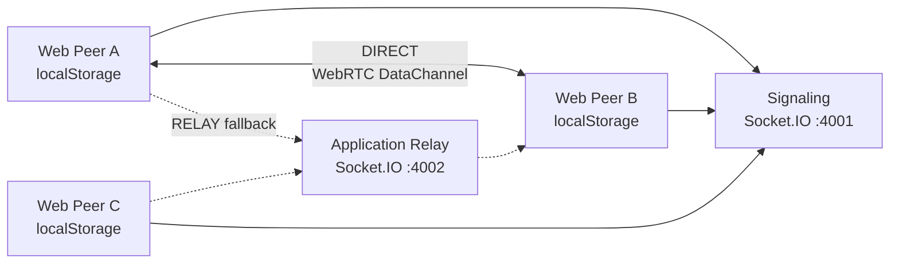
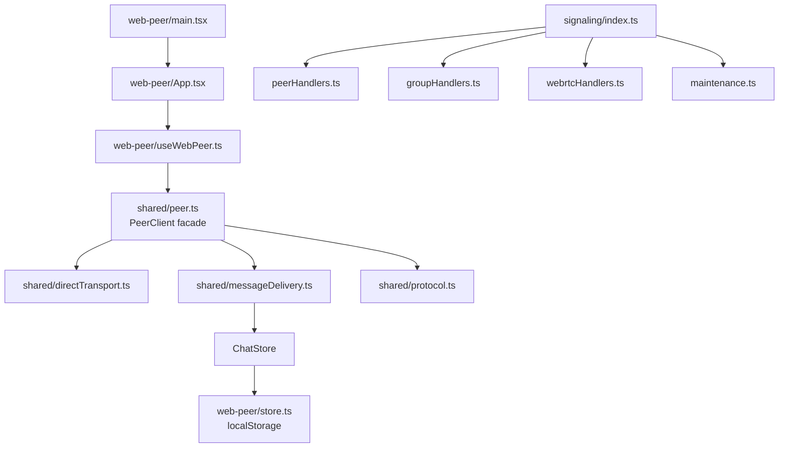

# Kiến trúc DS01

## Sơ đồ triển khai

Signaling và relay là hai process độc lập. Chúng có thể chạy trên cùng máy chủ nhưng có cổng, lifecycle và log riêng.

## Control plane

`src/signaling` xử lý:

- đăng ký Peer ID và cấp token relay;
- heartbeat, timeout và danh sách online;
- peer lookup;
- chuyển `request`, `offer`, `answer`, `ice`;
- tạo và cập nhật membership nhóm demo;
- kiểm tra phiên bản khi hai peer sửa nhóm gần đồng thời.

Signaling không nhận chat body. Nó chỉ giúp hai peer tìm nhau và thiết lập kết nối.

## Data plane

### DIRECT

`src/shared/directTransport.ts` quản lý `RTCPeerConnection`, ICE và DataChannel ordered. Peer ID nhỏ hơn tạo offer để tránh hai bên đồng thời tạo offer. Client chờ tối đa 5 giây; khi DataChannel mở, envelope đi thẳng peer-to-peer.

### RELAY

`src/relay` xác thực token do signaling cấp, ánh xạ Peer ID sang Socket.IO connection và chuyển envelope đúng receiver. Relay kiểm tra schema, sender, mode, kích thước, membership nhóm và trạng thái online trước khi ghi `FORWARD`.

Relay ứng dụng đọc envelope chat và khác TURN. Repository không triển khai TURN.

## Đảm bảo giao tin

`src/shared/messageDelivery.ts` chịu trách nhiệm:

- tạo Message ID, Session ID và sequence;
- trạng thái `pending → sent → delivered` hoặc `failed`;
- ACK do ứng dụng nhận tạo sau khi lưu tin;
- timeout ACK 2 giây và tối đa 3 attempt;
- chuyển lần retry sang RELAY;
- chống hiển thị trùng bằng Message ID và sender;
- multi-unicast nhóm với ACK riêng từng receiver.

Đây là at-least-once transmission trong thời gian retry kết hợp deduplication ở receiver. Hệ thống không lưu server queue cho peer offline.

## Cấu trúc mã

`PeerClient` là facade duy nhất mà giao diện cần biết. WebRTC, delivery và persistence phụ thuộc qua interface/callback, giúp thay web peer bằng Android hoặc desktop peer mà giữ nguyên protocol.

## NAT, STUN, TURN và relay ứng dụng

Peer sau NAT không thể dùng trực tiếp địa chỉ riêng của nhau. ICE thu thập candidate; STUN giúp peer biết candidate phản xạ công khai và thử NAT traversal. STUN không bảo đảm mọi NAT/firewall đều cho kết nối.

TURN relay packet ở tầng ICE/WebRTC và thường xuất hiện như một ICE candidate. Application relay trong dự án là Socket.IO route chat envelope sau khi DataChannel thất bại. Do dự án chưa triển khai TURN, báo cáo phải ghi đúng là “WebRTC DataChannel + application relay Socket.IO”.

## Giới hạn

- Nhóm web demo lưu RAM trong signaling.
- Lịch sử nằm tại peer, không đồng bộ qua server.
- Peer offline không nhận lại tin cũ.
- Không có total order giữa nhiều sender.
- Một signaling và một relay instance, chưa có replication/failover.
- Kết quả DIRECT và NAT phụ thuộc thiết bị, mạng và firewall thực tế.
