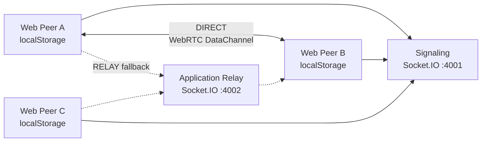
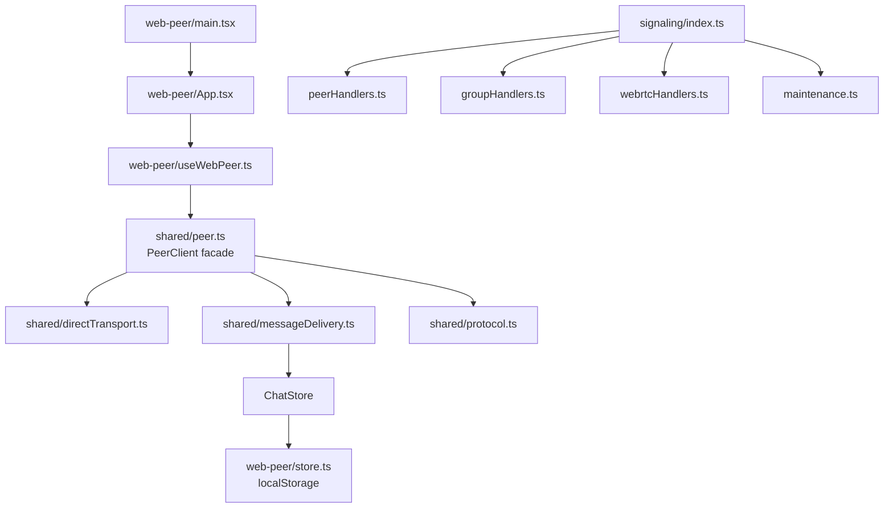

# Kiến trúc DS01

## Sơ đồ triển khai

Signaling và relay là hai process độc lập. Chúng có thể chạy trên cùng máy chủ nhưng có cổng, lifecycle và log riêng. CLI signaling lưu hash danh tính và nhóm vào atomic snapshot `.data/signaling.json`, chỉ một writer. Peer giữ outbound connection tới cùng pool tối đa bốn relay để failover.

## Control plane

`src/signaling` xử lý:

- đăng ký Peer ID và cấp token relay;
- heartbeat, timeout và danh sách online;
- peer lookup;
- chuyển `request`, `offer`, `answer`, `ice`;
- tạo và cập nhật membership nhóm demo;
- kiểm tra phiên bản khi hai peer sửa nhóm gần đồng thời.

Signaling không nhận chat body. Nó chỉ giúp hai peer tìm nhau và thiết lập kết nối.

## Data plane

### DIRECT

`src/shared/directTransport.ts` quản lý `RTCPeerConnection`, ICE và DataChannel ordered. Peer ID nhỏ hơn tạo offer để tránh hai bên đồng thời tạo offer. Client chờ tối đa 5 giây; khi DataChannel mở, envelope đi thẳng peer-to-peer.

### RELAY

`src/relay` xác thực token do signaling cấp, ánh xạ Peer ID sang Socket.IO connection và chuyển envelope đúng receiver. Relay kiểm tra schema, sender, mode, kích thước, membership nhóm và trạng thái online trước khi ghi `FORWARD`.

Relay ứng dụng đọc envelope chat và khác TURN. TURN tùy chọn qua ICE, được phân biệt nhờ selected candidate pair trong getStats; nếu không xác định được đường ICE, client đóng kết nối đó và fallback để tránh gọi sai DIRECT. Có mẫu coturn nhưng TURN public cần triển khai/kiểm thử riêng.

## Đảm bảo giao tin

`src/shared/messageDelivery.ts` chịu trách nhiệm:

- tạo Message ID, Session ID và sequence;
- trạng thái `pending → sent → delivered` hoặc `failed`;
- ACK do ứng dụng nhận tạo sau khi lưu tin;
- timeout ACK 2 giây và tối đa 3 attempt;
- chuyển lần retry sang RELAY;
- chống hiển thị trùng bằng Message ID và sender;
- multi-unicast nhóm với ACK riêng từng receiver.

Đây là best effort với số lần truyền lại hữu hạn, ACK ứng dụng và dedup có giới hạn; không bảo đảm at-least-once khi peer luôn offline. `failed` nghĩa chưa có xác nhận trong giới hạn thử, không khẳng định receiver chưa từng nhận. Retry thủ công giữ Message ID. Không có server queue cho peer offline.

Sequence/session khôi phục trước lần gửi đầu, logical time cập nhật khi nhận. `orderMessages` merge các chuỗi sender/session/conversation theo sequence, không dùng comparator không bắc cầu giữa sender khác nhau. Ngắt phiên hủy promise chờ và đánh dấu failed; pending/sent từ phiên gián đoạn cũng phục hồi thành failed.

File đi theo chunk 2304 byte qua cùng ACK/retry/transport. Receiver ghép đủ, kiểm tra SHA-256 rồi lưu IndexedDB; metadata sau cùng chỉ ACK khi byte file đã có và đã kiểm chứng. Chưa có resume file qua restart.

## Cấu trúc mã

`PeerClient` là facade duy nhất mà giao diện cần biết. WebRTC, delivery và persistence phụ thuộc qua interface/callback, giúp thay web peer bằng Android hoặc desktop peer mà giữ nguyên protocol.

## NAT, STUN, TURN và relay ứng dụng

Peer sau NAT không thể dùng trực tiếp địa chỉ riêng của nhau. ICE thu thập candidate; STUN giúp peer biết candidate phản xạ công khai và thử NAT traversal. STUN không bảo đảm mọi NAT/firewall đều cho kết nối.

TURN relay packet ở tầng ICE/WebRTC và xuất hiện trong ICE candidate. Application relay Socket.IO chuyển chat envelope sau khi DataChannel thất bại. Các đường được phân biệt DIRECT (ICE không relay), TURN (DataChannel qua TURN) và RELAY (application relay). Cấu hình TURN không thay thế bằng chứng chat qua application relay.

## Giới hạn

- Hash danh tính và nhóm có atomic snapshot ở một signaling; chưa replication signaling.
- Lịch sử nằm tại peer, không đồng bộ qua server.
- Peer offline không nhận lại tin cũ.
- Không có total order giữa nhiều sender.
- Pool relay có failover kết nối, chưa replication/offline queue giữa relay.
- Kết quả DIRECT và NAT phụ thuộc thiết bị, mạng và firewall thực tế.

## Tài khoản local và auto-connect

Luồng mặc định tạo tài khoản/đăng nhập rồi tự đăng ký peer với signaling. Peer ID user_ + username; mật khẩu scrypt với salt riêng; phiên bearer 12 giờ lưu hash tại server và token trong sessionStorage của tab. Logout thu hồi phiên và đóng peer. Relay xác minh session qua HTTP nội bộ, không đọc registry chia sẻ. Xem [authentication.md](authentication.md) cho event auth, lưu trữ, chính sách một peer online và giới hạn. Chế độ secret demo cũ nằm trong mục thử nghiệm kỹ thuật.
