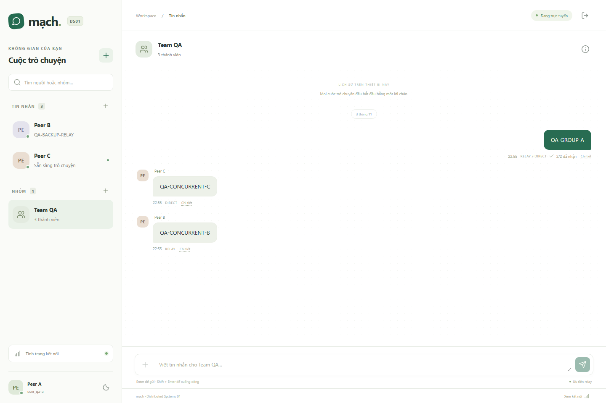
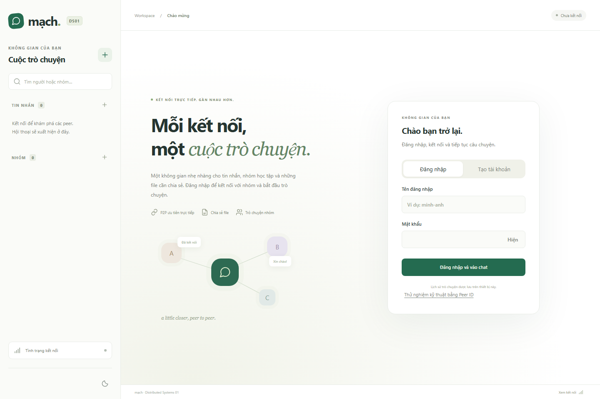

# MẠCH — HỆ THỐNG CHAT P2P DS01

**Bản dự thảo kỹ thuật sau cải thiện — chưa phải bản nộp cuối.**

Học phần: Hệ thống phân tán. Đề tài: DS01 — P2P chat mô phỏng Skype. Ngày chuẩn bị: 29/10/2026.

Thông tin lớp, giảng viên, tên/MSSV và phân công thành viên: **chưa được cung cấp**. Nhóm cần điền đúng đóng góp thật, bổ sung kết quả Internet/NAT và chốt bản báo cáo cuối. Không suy ra đóng góp cá nhân từ mã hoặc tự tạo lịch sử Git thay sinh viên.

## Tóm tắt

Mạch là prototype chat phân tán gồm web peer, bootstrap/signaling và application relay độc lập. Peer ưu tiên WebRTC DataChannel, sử dụng Socket.IO relay khi đường trực tiếp không lập được hoặc không nhận ACK. Nhóm dùng multi-unicast và ACK riêng từng receiver. Client lưu lịch sử tại thiết bị; signaling lưu bền ràng buộc Peer ID và nhóm bằng atomic snapshot.

Các cơ chế nhóm tự xây dựng gồm message identity/session/sequence, logical time, ACK ứng dụng, retry giới hạn, dedup có ledger, kiểm soát version membership, chính sách chuyển owner, phục hồi interrupted sends, relay pool failover và chuyển file theo chunk có SHA-256. Giao diện cung cấp chat cá nhân/nhóm, trạng thái đường truyền, tiến trình file và chẩn đoán.

Kiểm thử tách ba mức: unit/integration qua sockets thật; browser headless dùng WebRTC và IndexedDB thật trên localhost; nghiệm thu WAN/NAT ngoài môi trường local. Chỉ hai mức đầu đã có bằng chứng ở working tree này. Không khẳng định E2EE, offline store-and-forward hoặc signaling replication.

## 1. Bài toán, yêu cầu và phạm vi

DS01 yêu cầu nhiều peer gửi/nhận đồng thời, có danh tính, discovery, trực tiếp hoặc relay, lịch sử cục bộ và khả năng hoạt động khi peer bị NAT/firewall hạn chế. Signaling được phép hỗ trợ thiết lập kết nối nhưng không âm thầm đóng vai trò centralized chat server.

Các yêu cầu chung gồm ít nhất ba thành phần độc lập giao tiếp mạng, concurrency/consistency, ít nhất hai tình huống lỗi–phục hồi, xác thực/phân quyền/validation, log và đánh giá hiệu năng. Mục 9 yêu cầu tối thiểu 8 functional, 2 concurrency/conflict, 2 fault/recovery, 2 security/invalid-data và 1 performance experiment. Mười hai demo của 5.10 được ánh xạ trong MANUAL-ACCEPTANCE.md.

Phạm vi sản phẩm: prototype web với text/group/file cá nhân. Có đăng ký/đăng nhập tài khoản local, mật khẩu scrypt và tự kết nối peer. Peer ID tài khoản là user_ + username. Chế độ demo cũ vẫn dùng secret ngẫu nhiên cấp tại browser. Chưa có reset mật khẩu/email/MFA hoặc quản lý nhiều thiết bị. Adapter tài khoản/project từ hệ thống khác là extension point, không được trình bày như một Mobile API đã tự chứa trong repo.

## 2. Phân tích vấn đề hệ thống phân tán

| Vấn đề | Giải pháp trong prototype | Giới hạn |
|---|---|---|
| Naming và discovery | Peer ID, registry, lookup và presence/profiles | Một signaling |
| Private IP/NAT | ICE/STUN, TURN tùy chọn, outbound application relay | WAN phụ thuộc mạng và triển khai thật |
| Mất ACK hoặc gói trùng | UUID, ACK ứng dụng, 3 attempt, dedup | Retry hữu hạn, không unconditional at-least-once |
| Thứ tự khác nhau | Sender/session sequence, logical time, merge | Không total order toàn hệ thống |
| Sửa membership đồng thời | Version và optimistic concurrency | Các thay đổi được tuần tự tại một signaling |
| Peer/server rời mạng | Heartbeat/lease, transport disconnect, reconnect/failover | Không failover signaling |
| State sau restart | Local history, interrupted sends, atomic server snapshot | Không replication hoặc distributed transaction |
| File không toàn vẹn | Chunk bounds, metadata consistency, SHA-256 | Chưa resume transfer dở qua restart |

## 3. Kiến trúc triển khai

Signaling, mỗi relay và web server có process/lifecycle/port riêng. Peer chỉ dùng mạng để trao đổi control/data; localStorage/IndexedDB là persistence cục bộ, không dùng làm bus giữa các peer. State file signaling là dữ liệu nội bộ một writer, không phải shared-file communication giữa các server.

| Thành phần | Trách nhiệm |
|---|---|
| src/signaling | Đăng ký, profiles, heartbeat/lease, lookup, SDP/ICE, membership và quyền nhóm |
| src/relay | JWT auth, Peer ID → socket, validate envelope, forwarding và disconnect |
| src/shared | Protocol, PeerClient, DirectTransport, MessageDelivery, FileTransfer, ordering |
| src/web-peer | Giao diện React, localStorage history/contact/dedup, IndexedDB file |
| src/server-kit | Atomic state và guard/log dùng phía server |
| deploy | Caddy, Docker Compose và coturn sample |

Hai đường data chính là DataChannel giữa peer và relay Socket.IO. Chat body không đi qua các event signaling; signaling chỉ chuyển SDP/ICE và ID dùng kiểm tra quyền. Với nhóm, control-plane authorization vẫn phụ thuộc signaling khi gửi/nhận dù payload đi DIRECT.

## 4. Định danh, xác thực và discovery

Luồng mặc định gồm tạo tài khoản, đăng nhập và tự đăng ký peer. Username chuẩn hóa chữ thường; Peer ID cố định user_ + username. Mật khẩu dùng scrypt N=131072/r=8/p=1 với salt riêng; phiên ngẫu nhiên 32 byte lưu hash tại server, token tại sessionStorage, hết hạn sau 12 giờ. Đăng xuất thu hồi phiên; relay kiểm tra phiên qua HTTP nội bộ khi handshake và forwarding. Một tài khoản chỉ có một peer online. Chi tiết trong docs/authentication.md.

Peer ID gồm 3–32 chữ/số/underscore/hyphen. Trong chế độ demo kỹ thuật, Web tạo secret ngẫu nhiên lưu theo ID trong browser; signaling chỉ giữ SHA-256 hash ràng buộc ID với secret. Đây là cơ chế đăng ký đầu tiên giữ quyền sở hữu ID, không phải xác thực danh tính ngoài đời. Sau restart, registry vẫn giữ hash nên secret khác không chiếm lại ID cũ.

Registration kiểm tra ID, identity proof, tên hiển thị và trùng phiên online. Relay token được signaling ký bằng PEER_SECRET, khác vai trò JWT_SECRET dùng adapter account. Relay xác minh token và đối chiếu sender của envelope với subject; client không tự chọn sender khác.

Peer đã đăng ký nhận presence và profiles. Lookup trả trạng thái online, lastSeen và transport capabilities; không trả secret/token/socket ID của người khác. Heartbeat app mỗi 10 giây, lease 30 giây, quét 5 giây. Socket disconnect có thể được phát hiện sớm hơn hết lease; hai loại thời gian được đo riêng.

## 5. Thiết lập kết nối và NAT

Nguồn chọn Peer ID từ discovery/hội thoại, lookup khi signaling đang kết nối, rồi thử DataChannel. Peer ID nhỏ hơn làm offer; negotiation đang chạy được dùng lại để tránh tạo offer chồng nhau. SDP/ICE chuyển qua signaling. ICE candidate được đệm trước remote description.

Sau DataChannel open, client kiểm tra selected candidate pair qua getStats trước khi báo ready. Nếu candidate không relay thì mode DIRECT; nếu có relay candidate thì TURN. Nếu không xác định được đường, client không tự tuyên bố DIRECT mà chuyển application relay. DIRECT failure được đánh dấu cooldown, sau cooldown có thể tạo kết nối mới.

DataChannel không mở trong timeout hoặc gửi/ACK lỗi dẫn tới RELAY. Relay giữ outbound connections từ peer nên không đòi peer mở inbound port. Checkbox ưu tiên relay là công cụ chọn route, không phải bằng chứng NAT. Chứng minh fallback bằng đóng một PC đang hoạt động khác với chứng minh mạng thật chặn đường trực tiếp.

TURN tùy chọn qua VITE_ICE_SERVERS, có sample coturn. Chưa có nghiệm thu coturn public trong working tree này. DataChannel qua TURN không được trình bày như P2P không qua server.

## 6. Protocol và reliable delivery

Envelope chứa Message ID, Session ID, sender/receiver, group khi có, type, timestamp, body, mode, attempt, sequence và logicalTime. Types gồm text, attachment, file-chunk và ack; ACK dùng ackFor trỏ Message ID gốc. Zod kiểm tra schema, tối đa 4000 ký tự text và 8192 byte wire. UTF-8 có thể đạt giới hạn byte trước giới hạn ký tự.

Sender lưu pending, gửi qua transport, chuyển sent và chỉ delivered khi nhận ACK ứng dụng đúng sender/session/Message ID. ACK Socket.IO từ relay chỉ xác nhận server xử lý request, không thay ACK receiver. Receiver lưu trước ACK; duplicate không lưu lại nhưng vẫn ACK để nguồn dừng retry.

Timeout ACK mặc định 2 giây, tối đa 3 attempt. Sau lỗi DIRECT, lần thử tiếp dùng RELAY. Nếu mọi lần không được xác nhận, trạng thái failed. Đây là best effort với bounded retransmission; failed không chứng minh receiver chắc chắn chưa từng nhận, vì ACK có thể mất. Retry thủ công text giữ Message ID để dedup còn tác dụng.

Peer close reject các promise chờ và dừng transport. Khi khởi tạo phiên mới, các pending/sent chưa hoàn tất được đánh dấu failed; không âm thầm biến thành delivered hoặc treo vĩnh viễn. UI chỉ gửi lại khi người dùng chọn retry.

## 7. Ordering và mô hình nhất quán

Sequence tăng theo sender/conversation, được khôi phục từ lịch sử; session cá nhân được giữ qua restart khi lịch sử còn. Logical time cập nhật theo thời gian đã quan sát và khi nhận, giúp merge ổn định. Bản sửa không chỉ sort timestamp rồi UUID vì hai tin cùng timestamp hoặc đồng hồ lùi sẽ đảo sequence.

orderMessages tạo các chain theo conversation/sender/session, sort sequence trong chain rồi merge các đầu chain theo logical time và tie-break ổn định. Cách này giữ thứ tự sender và tránh comparator không bắc cầu khi so nhiều sender. Với lịch sử tối đa 1000 dòng, chi phí merge đơn giản chấp nhận được cho prototype.

Không bảo đảm total order hoặc causal broadcast giữa mọi sender. Hai receiver có thể quan sát hai tin gửi đồng thời từ B/C theo thứ tự khác nhau, miễn không mất/trùng và không phá thứ tự cùng sender. Dữ liệu cũ không có logicalTime vẫn được xử lý bằng timestamp và chain sequence.

## 8. Nhóm và concurrency control

Nhóm có ID, tên, owner, members và version. Create/add giới hạn tối đa 16 thành viên. Owner thêm người; owner hoặc chính thành viên có thể xóa. Khi owner rời nhóm, Peer ID nhỏ nhất còn lại làm owner; nhóm rỗng archived.

Client gửi version đã biết trong group:change. Signaling chỉ chấp nhận nếu version hiện tại khớp, tạo state tiếp theo, lưu snapshot thành công rồi mới phát group:update/ACK. Hai thao tác cùng version chỉ một được chấp nhận; thao tác còn lại bị stale để caller lấy state mới, tránh lost update.

Chat nhóm là multi-unicast: một Message ID chung nhưng envelope riêng tới từng receiver. ACK/status lưu theo receiver, UI gộp thành một bubble nhưng Chi tiết vẫn hiện từng người. Người offline giữ membership, lần gửi đến họ failed; không có offline queue. Người bị xóa giữ lịch sử cũ nhưng không nhận/gửi được tin nhóm mới nếu không được thêm lại.

## 9. Chuyển file và toàn vẹn dữ liệu

File cá nhân tối đa 512 KiB, chia chunk 2304 byte, mỗi chunk có envelope/ACK/retry. Base64 chunk tối đa 3072 ký tự để vừa wire budget cùng metadata. Receiver kiểm tra count/index/size, metadata nhất quán và duplicate chunk content; assembly tối đa 4 transfer, bỏ dở sau 2 phút.

Ghép đủ byte mới tính SHA-256 và ghi IndexedDB. File sai hash bị từ chối, giữ tombstone ngắn để retry chunk cuối không được ACK nhầm như transfer mới chưa đủ. Sau tất cả chunk ACK, nguồn gửi attachment notification. Receiver chỉ ACK notification có hash nếu đã có byte file được xác minh; reload giữa chừng không được tạo delivered giả.

UI hiển thị tiến trình và tải về từ IndexedDB. SHA-256 kiểm tra toàn vẹn, không phải chữ ký xác minh tác giả độc lập; binding tác giả do session/auth/transport. Chưa resume transfer dở hoặc gửi file nhóm. File được tải như dữ liệu, không tự thực thi markup.

## 10. Fault tolerance, relay failover và phục hồi

Pool tối đa 4 relay khác nhau; cả hai peer duy trì outbound connection tới cùng pool. Khi relay ưu tiên không dùng được hoặc forwarding lỗi, client thử relay còn kết nối. Cùng ID được giữ nếu cần retransmit; receiver dedup kể cả tin đến từ nhiều relay.

Failover này không sao chép offline queue hoặc tạo consensus giữa relay. Relay không giữ chat history; signaling vẫn kiểm tra membership và là điểm lỗi đơn. Restart signaling lấy lại hash/groups từ file và các browser tự đăng ký/nối lại. Một signaling writer cho một state file; registry hỏng không được tự reset.

Các failure model được kiểm tra: peer/transport ngắt, DataChannel chưa mở hoặc đang mở bị đóng, ACK vắng, relay dừng, signaling restart, duplicate, state hỏng và file hash sai. WAN loss, host failure nhiều máy và TURN public vẫn cần môi trường triển khai thật.

## 11. Bảo mật và quản lý dữ liệu

Các biện pháp gồm JWT relay, sender binding, quyền nhóm, local block cho chat cá nhân, schema/size validation, callback guard, event rate budget, secret qua env và log có thời gian/service/event. Production từ chối secret thiếu, ngắn hoặc placeholder. .env/.data không commit; bootstrap tạo secret ngẫu nhiên mà không in ra log.

State snapshot ghi tệp tạm rồi rename; nếu ghi lỗi thì mutation nhóm không được broadcast thành công. Đây là atomic update cho một writer, không thay thế cơ sở dữ liệu replicated hoặc bảo đảm mọi kiểu power-loss. Cần backup và quyền file phù hợp môi trường chạy.

Web giữ tối đa 1000 dòng history và 10000 dedup keys; file trong IndexedDB theo scope peer. Không tuyên bố exactly-once vĩnh viễn. Xóa lịch sử không xóa registry danh tính server. Mất browser storage có thể mất secret, nhóm cần có quy trình bảo quản profile; không có endpoint tự chiếm lại ID của người khác.

Relay Socket.IO đọc payload; chưa E2EE. HTTPS/WSS bảo vệ transport khi triển khai đúng nhưng không loại quyền đọc của relay. TURN credentials gửi cho browser là credential dùng ICE, không phải PEER_SECRET/JWT_SECRET.

## 12. Kết quả kiểm thử tự động

{{EVIDENCE_SUMMARY}}

Các test regression gồm callback sai kiểu, identity/group restart, registry hỏng, ownership transfer, equal-clock ordering, interrupted ACK wait/recovery, concurrent contact writes, failover relay, full-file byte/hash verification và corruption rejection. Vitest dùng sockets thật nhưng không tự chứng minh browser/NAT; browser suite tách riêng.

Browser acceptance dùng ba context cách ly, signaling/primary relay/backup relay/web ở process riêng, profile tạm. Có kiểm tra DIRECT thật không FORWARD, đóng PC rồi fallback không bật checkbox, file/IndexedDB, group/concurrent sends, reload history, signaling restart, backup relay và mobile overflow. Ảnh chụp không dùng dữ liệu người dùng thật.

## 13. Thí nghiệm hiệu năng và khả năng mở rộng

{{LOAD_SUMMARY}}

Phép đo tạo simulated headless peers trong một process, mỗi peer có kết nối mạng riêng tới services. Thời gian kết thúc khi Socket.IO recipient nhận, không đo ACK ứng dụng hoặc persistence. p50/p95/max không được dùng làm latency WAN. Serialized payload bytes chỉ là ước lượng, không gồm overhead đầy đủ TCP/TLS/Socket.IO.

Fan-out nhóm n người cần n−1 envelope mỗi tin; relay ingress/egress tăng theo số receiver và kích thước payload. Chunk file phát sinh nhiều ACK và thao tác hash/storage. Hạn chế 16 người/nhóm, 512 KiB/file, rate budget và bounded retries giới hạn tài nguyên ở prototype.

Để mở rộng: nhiều relay phân tán host/region, đo chọn relay theo latency/load, tách metrics, cân nhắc persistent queue/replication và replicated signaling với authority/version rõ. Những hướng này không được xem là đã triển khai chỉ vì có relay pool.

## 14. Triển khai và tái lập kết quả

Node ^20.19 hoặc >=22.12 đáp ứng app; browser QA dùng Node 22.12+ và Chromium đã cài. npm ci, init-env, ba lệnh start:signaling/start:relay/dev:web là đường chạy local. npm run test:browser tự tạo port/profile/state lab, không dừng server đang dùng; không cần dữ liệu nhóm thật.

deploy có Dockerfile/Compose gồm signaling, primary/backup relay và static web; named volume giữ signaling state. Có Caddy reverse proxy/HTTPS mẫu và coturn lab mẫu. Docker runtime chưa được cài ở môi trường kiểm tra này; không tuyên bố đã build/run container. Cần thử trên máy nhóm và giữ log.

Khi public: điền domain thật, server secrets thật, HTTPS/WSS, build lại VITE_* URLs. SIGNAL_INTERNAL_URL phải trỏ đúng signaling từ relay. Không dùng localhost như endpoint của máy chủ từ browser ở máy khác. Không dùng cùng snapshot cho nhiều writer hoặc xóa volume trong phép thử restart.

## 15. Hạn chế, công việc cần bổ sung và kết luận

Mã hiện tại giải quyết các lỗi đã tái hiện và bổ sung file transfer, relay failover, ICE configuration và giao diện mới. Local integration/browser cho thấy control/data plane hoạt động theo thiết kế trong phạm vi đã chạy.

Nhóm vẫn cần endpoint public, chứng cứ khác mạng/NAT, TURN nếu muốn nghiệm thu tính năng đó, kết quả Docker, thông tin/phân công thật, commit cá nhân, tag/release và demo cả nhóm. Bản báo cáo cuối nên bổ sung topology mạng thực, ảnh/log lỗi–phục hồi, phân tích số đo và thông tin học phần; đề khuyến nghị 20–30 trang không tính phụ lục. Không kéo dài bằng kết quả chưa chạy hoặc dữ liệu giả.

Phạm vi chưa triển khai: E2EE, offline store-and-forward, DHT, voice/video, election super-peer và signaling replication. Chúng thuộc các hướng nâng cao khác, không cần làm tất cả để đáp ứng chức năng tối thiểu.

## Tài liệu tham khảo và nguồn

- COURSE PROJECT SPECIFICATION.pdf do giảng viên cung cấp, mục 4, 5, 9–13.
- Source code và test trong repository này; source fingerprint và commit kèm bằng chứng, working tree có thể chưa được commit.
- [W3C WebRTC specification](https://www.w3.org/TR/webrtc/), API RTCPeerConnection/DataChannel và stats.
- [Socket.IO documentation](https://socket.io/docs/v4/), event/ACK/reconnection.
- [Caddy reverse_proxy](https://caddyserver.com/docs/caddyfile/directives/reverse_proxy), reverse proxy và WebSocket.
- [coturn configuration example](https://github.com/coturn/coturn/blob/master/examples/etc/turnserver.conf), các tùy chọn TURN lab.
- React, Vite, TypeScript, Zod, Express, jsonwebtoken và các thư viện theo package-lock.json. Nhóm cần trích nguồn hình/thuật toán bổ sung nếu sử dụng tài liệu khác.

## Phụ lục: nghiệm thu thủ công

Xem MANUAL-ACCEPTANCE.md và manual-results.csv. Mỗi lỗi lưu Test ID, điều kiện trước thử, bước tái hiện, mong đợi/thực tế, Message ID/Group ID/version, bằng chứng, người xử lý, commit sửa và retest. Bảng thủ công không tự chuyển PASS khi code có tên tính năng tương ứng.
